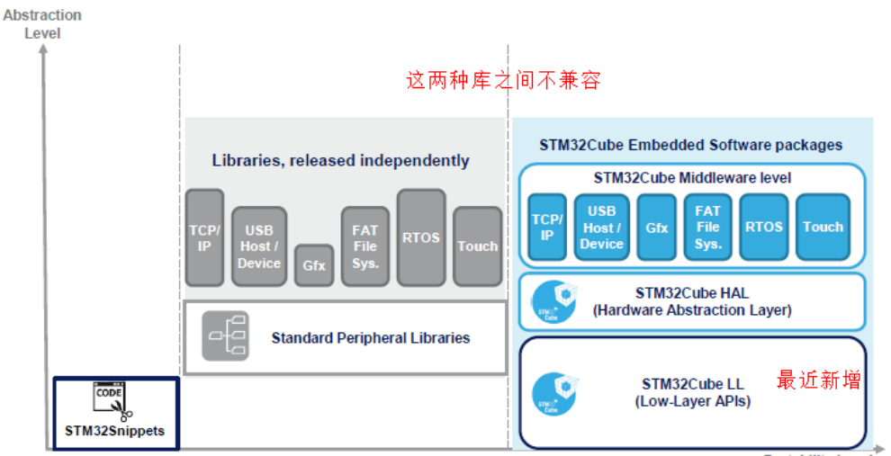

# STM32 4_HAL 库简介

ST 为开发者提供了非常方便的开发库。到目前为止，有标准外设库(STD 库)、HAL 库、LL 库 三种。

### 标准外设库(标准库)

标准外设库（Standard Peripherals Library）是对 STM32 芯片的一个完整的封装，包括所有标准器件外设的器件驱动器。~~这应该是目前使用最多的 ST 库~~。几乎全部使用 C 语言实现。但是，标准外设库也是针对某一系列芯片而言的，没有可移植性。
  相对于 HAL 库，标准外设库仍然接近于寄存器操作，主要就是将一些基本的寄存器操作封装成了 C 函数。开发者需要关注所使用的外设是在哪个总线之上，具体寄存器的配置等底层信息。

标准库不支持从 STM32 L0，L4 和 F7 开始的之后的 STM32 系列芯片。

ST 为各系列提供的标准外设库稍微有些区别。例如，STM32F1x 的库和 STM32F3x 的库在文件结构上就有些不同，此外，在内部的实现上也稍微有些区别，这个在具体使用（移植）时，需要注意一下！但是，不同系列之间的差别并不是很大，而且在设计上是相同的。STM32 的标准外设库涵盖以下 3 个抽象级别：

- 包含位，位域和寄存器在内的完整的寄存器地址映射
- 涵盖所有外围功能（具有公共 API 的驱动器）的例程和数据结构的集合。
- 一组包含所有可用外设的示例，其中包含最常用的开发工具的模板项目。

### HAL 库

HAL 是 Hardware Abstraction Layer 的缩写，中文名：硬件抽象层。HAL 库是 ST 为 STM32 最新推出的抽象层嵌入式软件，可以更好的确保跨 STM32 产品的最大可移植性。该库提供了一整套一致的中间件组件，如 RTOS，USB，TCP / IP 和图形等。
  HAL 库是基于一个非限制性的 BSD 许可协议（Berkeley Software Distribution）而发布的开源代码。 ST 制作的中间件堆栈（USB 主机和设备库，STemWin）带有允许轻松重用的许可模式， 只要是在 ST 公司的 MCU 芯片上使用，库中的中间件(USB 主机/设备库,STemWin)协议栈即被允许随便修改，并可以反复使用。至于基于其它著名的开源解决方案商的中间件（FreeRTOS，FatFs，LwIP 和 PolarSSL）也都具有友好的用户许可条款。
  可以说 HAL 库就是用来取代之前的标准外设库的。相比标准外设库，STM32Cube HAL 库表现出更高的抽象整合水平，HAL API 集中关注各外设的公共函数功能，这样便于定义一套通用的用户友好的 API 函数接口，从而可以轻松实现从一个 STM32 产品移植到另一个不同的 STM32 系列产品。HAL 库是 ST 未来主推的库，从前年开始 ST 新出的芯片已经没有 STD 库了，比如 F7 系列。目前，HAL 库已经支持 STM32 全线产品。

### LL 库

LL 库（Low Layer）是 ST 最近新增的库，与 HAL 捆绑发布，文档也是和 HAL 文档在一起的，比如：在 STM32F3x 的 HAL 库说明文档中，ST 新增了 LL 库这一章节，但是在 F2x 的 HAL 文档中就没有。
  LL 库更接近硬件层，对需要复杂上层协议栈的外设不适用，直接操作寄存器。其支持所有外设。使用方法：

- 独立使用，该库完全独立实现，可以完全抛开 HAL 库，只用 LL 库编程完成。在使用 STM32CubeMX 生成项目时，直接选 LL 库即可。如果使用了复杂的外设，例如 USB，则会调用 HAL 库。
- 混合使用，和 HAL 库结合使用。