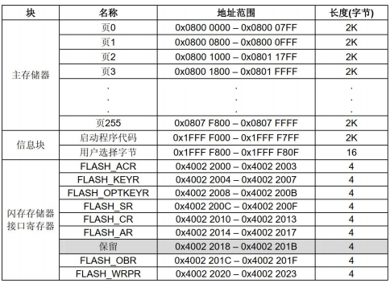
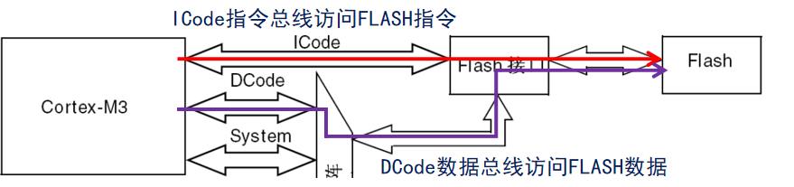
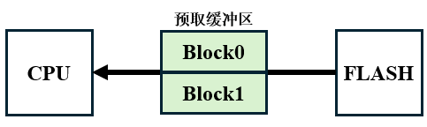
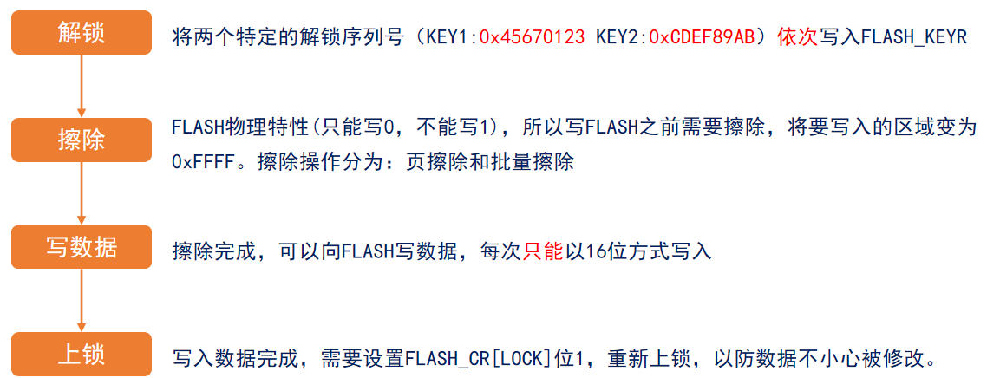
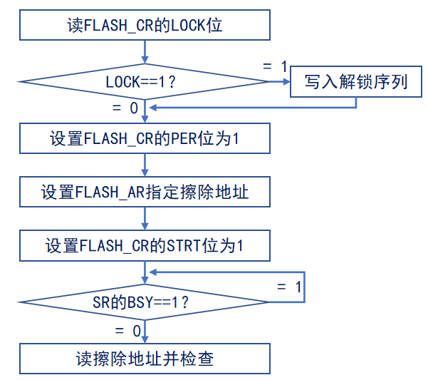
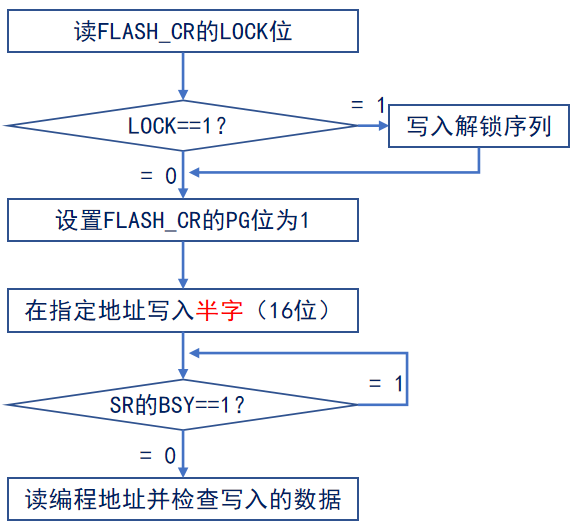

# STM32 FLASH

## 1. STM32 内部 FLASH 简介

一个 32 位地址指向 1 个字节，FLASH 空间多少多少 K 指的是多少多少 K byte。

FLASH 是闪存，是一种长寿命的非易失性（断电数据不丢失）的存储器。可以对称为块的存储器单元块进行擦写和再编程，在进行写入操作之前必须先执行擦除。

内部 FLASH 用于保存要运行的代码和常量，外部 FLASH 用于存储需要掉电保存的用户数据。在 STM32 芯片内部有一个 FLASH 存储器，主要用于存储代码。

- 根据闪存容量划分为几个密度等级：

  | **密度等级** | **容量范围**       | **类型**     |
  | ------------ | ------------------ | ------------ |
  | 低密度 LD    | ≤ 32KB             | 小容量产品   |
  | 中密度 MD    | 32KB ＜ X ≤ 128KB  | 中容量产品   |
  | 高密度 HD    | 128KB ＜ X ≤ 512KB | 大容量产品   |
  | 超密度 XD    | ＞ 512KB           | 超大容量产品 |

  不同密度等级的 FLASH，其组织结构也不一样。

- STM32 内部 FLASH 构成：

  内部 FLASH 主要由三部分组成：**主存储器、信息块、闪存存储器接口寄存器**。

  | **闪存模块的子部分** | **作用**                                                     |
  | -------------------- | ------------------------------------------------------------ |
  | 主存储器             | 用来存放代码和数据常数（如 `const` 类型的数据）              |
  | 信息块               | 分为两个部分：系统存储（启动程序代码）、选项字节（用户选择字节） |
  | 闪存存储器接口寄存器 | 用于控制闪存读写等，是整个闪存模块的控制结构                 |

  

  > 1. 主存储器：地址范围为 `0x0800 0000` ~ `0x0807 FFFF`，分为 256 页，每页 `2KB`（小/中容量为 `1K`）。当 `BOOT0` 接地，系统将从 `0x0800 0000` 地址处开始读取代码（从主存储器启动）。
  > 2. 信息块：
  >    - 系统存储器是用于存放在系统存储器自举模式下的启动程序，这个区域只保留给 ST 使用，启动程序使用 `USART1` 串行接口实现对闪存存储器的编程；ST 在生产线上对这个区域编程并锁定以防止用户擦写。
  >    - 选项字节：选项字节存储芯片的配置信息及对主存储块的保护信息。用于配置 FLASH 的读写保护、电源管理中的 BOR 级别、软件/硬件看门狗等功能，这部分共 32 字节。可以通过修改 FLASH 的选项控制寄存器修改。
  >    - 当 `BOOT0` 接 VCC，`BOOT1` 接 GND（串口下载程序），系统运行的就是这部分代码。

- FLASH 的保护方式：

  闪存存储器有两种保护方式防止非法的访问（读、写、擦除）：**页写入保护和读出保护**。

  在执行闪存写操作时，任何对闪存的读操作都会锁住总线，在写操作完成后读操作才能正确地进行；即在进行写或擦除操作时，不能进行代码或数据的读取操作。

  进行闪存编程操作时（写或擦除），必须打开内部的 RC 振荡器（HSI）。

- FLASH 的编程方式：

  **闪存存储器可以用 ICP 或 IAP 方式编程。**

  - IAP（In-Application Programming）（在程序中编程）：IAP 是在用户程序运行时对闪存微控制器中存储器重新编程。通过任何一种通信接口（如 IO 端口，USB，CAN，UART，I2C，SPI 等）下载程序或者应用数据到存储器中。也就是说，STM32 允许用户在应用程序中重新烧写闪存存储器中的内容。然而，IAP 需要至少有一部分程序已经使用 ICP 方式烧到闪存存储器中（Bootloader）。

  - ICP（In-Circuit Programming）（在线编程）：ICP 是在芯片安装到用户应用板上后，通过 JTAG 协议对闪存微控制器中存储器编程。通过 JTAG/SWD 协议或者系统加载程序（Bootloader）下载用户应用程序到微控制器中。

## 2. STM32 内部 FLASH 的读写操作

### 读取操作

直接在通用地址空间直接寻址，任何 32 位数据的读操作都能访问闪存模块的内容并得到相对应的数据。



> CPU 运行速度比 FLASH 快得多，STM32F103 的 FLASH 最快访问速度 ≤24MHz，CPU 频率超过这个速度，得加入等待时间，否则读写 FLASH 可能出错，导致死机等情况。
>
> | **频率范围**              | 等待周期数（`LATENCY`） |
> | ------------------------- | --------------------- |
> | 0 ＜ `SYSCLK` ＜ 24MHz    | 0 个等待周期          |
> | 24MHz ＜ `SYSCLK` ≤ 48MHz | 1 个等待周期          |
> | 48MHz ＜ `SYSCLK` ≤ 72MHz | 2 个等待周期          |

正确设置好等待周期后，利用指针读取数据。

```c
// 从地址addr，读取数据（字节为8位，半字为16位，字为32位）
data = *(volatile uint8_t *)addr;		/* 读取一个字节数据 */
data = *(volatile uint16_t *)addr;		/* 读取一个半字数据 */
data = *(volatile uint32_t *)addr;		/* 读取一个字数据 */
```

---

***指令预取：***

程序一般保存在片上 FLASH 中，CPU 执行程序时需要不断从 FLASH 读取指令。当 CPU 主频较高时，FLASH 不一定能在一个 CPU 时钟周期内完成指令读取，通常需要让 CPU 等待若干个周期直到数据准备完毕。

可以使用指令预取进行性能优化。利用 CPU 执行已有指令的时间，让 FLASH 提前准备后续指令，尽可能隐藏 FLASH 的部分读取延迟。

**指令预取优化 CPU 通过 I-Code 总线从 FLASH 获取指令**。在 CPU 和 FLASH 间存在两个 64 位块组成的预取缓冲区。



> 数据读取和指令读取竞争 FLASH 接口时，D-Code 的数据访问有优先权。

预取缓冲区每个 Block 的宽度和 FLASH 的一次读取宽度相匹配，一个块可以通过一次 FLASH 读取填充。

缓冲区采用直接映射方式。因此会发生映射冲突（FLASH 中的某个地址块，只能放到缓冲区中由映射规则指定的位置）。

> 假设预取缓冲区最初是：Block 0 放置主存储区块 0 的程序，Block 1 放置主存储区块 1 的程序，此时程序跳转，需要进入主存储区块 2 的程序。如果映射规则是奇数存储块放置到 Block 1，偶数存储块防止到 Block 0，则此时 Block 0 放置主存储区块 2 的程序，如果程序很快跳回块 0，则需要重新读取 Flash。称为映射冲突。

Cortex-M3 执行 Thumb 指令，一个 8 字节块可以容纳 4 条 16 位指令或容纳 2 条 32 位指令；或者混合指令。

指令预取时，顺序执行的逻辑如下：

> - 时刻 1：CPU 执行指令 A，FLASH 接口将指令 B 送入预取缓冲区；
> - 时刻 2：CPU 执行指令 B，FLASH 接口将指令 C 送入预取缓冲区；
> - ...

性能优化的效果效果取决于能否在 CPU 需要下一个指令之前完成读取。如果 CPU 很快就用完当前指令，而下一个指令尚未准备好，仍然会发生等待。但是此时的等待时间也会有缩减。

预取通常最容易帮助连续地址上的指令执行。当程序执行跳转时，后续需要的地址可能不再是顺序地址。假设处理器当前在执行条件判断附近的指令，而 FLASH 接口已经准备了后面的顺序指令，如果跳转目标不在当前可用的预取块中，就需要读取新的 FLASH 块，CPU 可能因此等待。

因此，以下的因素会影响预取效果：

> - 程序的顺序性；
> - 分支频率；
> - D-Code 数据读取；
> - 代码对齐与指令长度；

STM32F1 中，切换预取开关状态需要满足：`SYSCLK` < 24 MHz，AHB 不分频。工程通常在启动早期，芯片仍运行在内部 8 MHz HSI、且 AHB 不分频时完成预取开启。在 F1 中存在规定：当 AHB 预分频系数不为 1 时，预取必须保持开启。

STM32F1 使用 FLASH 访问控制寄存器 `FLASH_ACR` 的 `PRFTBE` 位配置预取使能：

```c
__HAL_FLASH_PREFETCH_BUFFER_ENABLE();
```

### 写入操作

闪存编程是由 `FPEC`（闪存编程和擦除控制器）模块处理的。**写操作有四步：解锁，擦除，写数据，上锁。**



- FLASH 擦除：

  

- FLASH 写入：

  

## 3. HAL 库函数

```c
/**
  * @brief  解锁 FLASH
  */
HAL_StatusTypeDef HAL_FLASH_Unlock(void);

/**
  * @brief  锁定 FLASH
  */
HAL_StatusTypeDef HAL_FLASH_Lock(void);

/**
  * @brief  FLASH 半字/字/字节写入
  * @note   使用前应当对 FLASH 解锁，使用后对 FLASH 加锁
  * @note   FLASH 应当被提前擦除
  * @param  TypeProgram:  写入方式
  * @param  Address:      写入地址
  * @param  Data:         写入数据
  */
HAL_StatusTypeDef HAL_FLASH_Program(uint32_t TypeProgram, uint32_t Address, uint64_t Data);

/**
  * @brief  大量擦除或擦除指定的闪存扇区
  * @note   使用前应当对 FLASH 解锁，使用后对 FLASH 上锁
  * @param[in]   Flash擦除结构体
  * @param[out]  擦除过程的错误代码
  */
HAL_StatusTypeDef HAL_FLASHEx_Erase(FLASH_EraseInitTypeDef *pEraseInit, uint32_t *PageError);

typedef struct
{
  uint32_t TypeErase;   /* 擦除类型 */
  uint32_t Banks;      /* 擦除的bank编号（整片擦除） */
  uint32_t PageAddress; /* 擦除页面地址 */
  uint32_t NbPages;     /* 擦除的页面数 */                 
} FLASH_EraseInitTypeDef;
```
