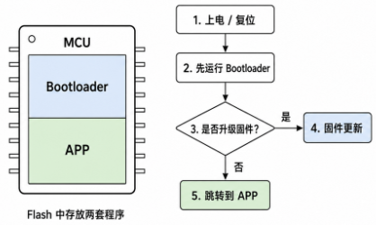
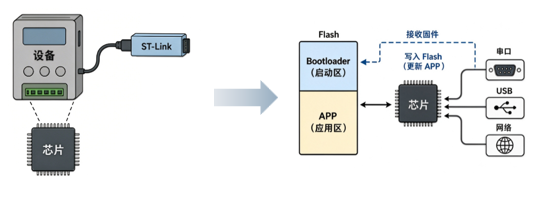
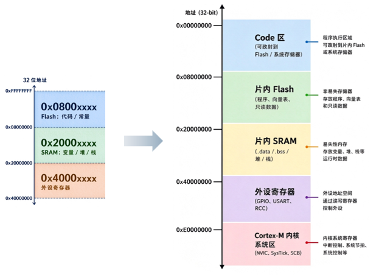
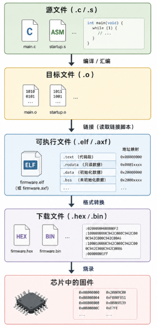
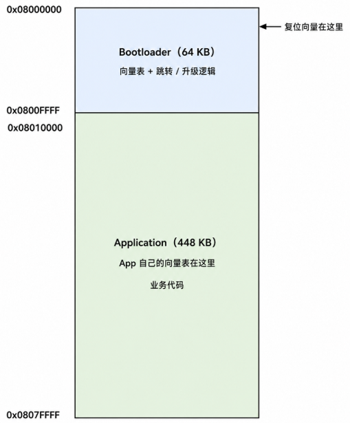
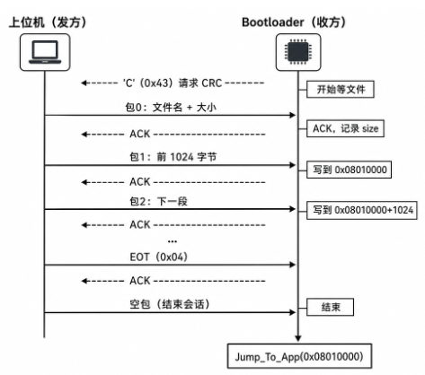
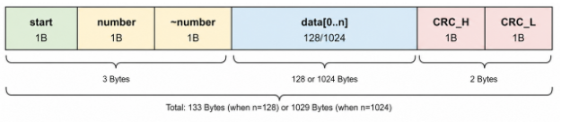
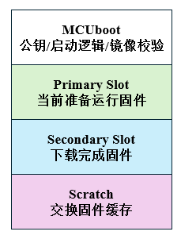
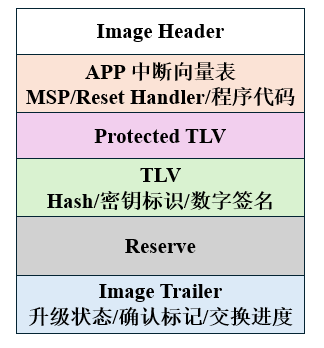

# Bootloader

Bootloader 是嵌入式系统内芯片上电/复位后最先运行的一段引导程序。Bootloader 不实现芯片的业务功能，而是用于决定芯片进入哪一段程序。

嵌入式系统产品中通常存放两套程序：一套 Bootloader，一套 APP。复位后 CPU 从 Bootloader 开始执行。



如果不使用 Bootloader，程序通常依赖调试器进行整片烧录，但是如果设备已经装到现场，或者需要远程升级，使用调试器会非常麻烦。



## 1. STM32 的启动文件/启动流程

STM32 的工程中通常有 `startup_stmxxxx.s` 的文件，该文件为启动文件，主要完成以下任务：

> 1. 提供中断向量表，提供复位后的栈地址，指令执行地址，中断执行地址；
> 2. 提供 `Reset_Handler`，完成上电后最开始的初始化；
> 3. 为中断提供默认处理函数。

### 启动文件结构

> 以 ARMCC/ARMCLANG 工具链下的启动文件为例，其使用 ARM 传统的汇编语法 armasm。

---

**堆栈空间定义：**

```asm
Stack_Size EQU 0x400						
; 定义栈大小
; EQU 用于定义常量

AREA STACK, NOINIT, READWRITE, ALIGN=3		
; 定义栈的内存段, 不需要初始化, 可读写, 8字节对齐 
Stack_Mem  SPACE Stack_Size					
; 在内存中分配大小为 Stack_Size 的空间, 标记为 Stack_Mem
; Stack_Mem 为低地址(栈底)
__initial_sp								
; Stack_Mem 空间结束后的下一个地址为 __initial_sp(Stack_Mem + Stack_Size)
; 由于 Cortex_M 内核的栈是向下增长的, __initial_sp 的地址为栈顶

Heap_Size EQU 0x200							
; 定义堆大小

AREA HEAP, NOINIT, READWRITE, ALIGN=3		
; 定义堆的内存段, 不需要初始化, 可读写, 8字节对齐 
__heap_base									
; 定义堆的低地址
Heap_Mem SPACE Heap_Size					
; 在内存中分配大小为 Heap_Size 的空间, 标记为 Heap_Mem
__heap_limit								
; 定义堆的高地址(Heap_Mem + Heap_Size)
```

---

**处理器运行属性：**

```asm
PRESERVE8									
; 8字节栈对齐
THUMB										
; Cortex-M 使用 THUMB 指令集
```

---

**中断向量表：**

```asm
AREA RESET, DATA, READONLY
; 定义只读数据段, 该段存储于 FLASH 中

EXPORT  __Vectors
EXPORT  __Vectors_End
EXPORT  __Vectors_Size
; 将向量表的起始地址, 终止地址和向量表大小导出为全局符号, 链接器和 C/C++ 文件可见

__Vectors DCD __initial_sp	
          DCD Reset_Handler 
; DCD - 在当前位置分配 32 bit 内存空间, 将其后的地址填入该空间
; 向量表的第0项 - MSP(主堆栈指针) 初始地址, 设置为栈顶
; 向量表的第1项 - 复位程序入口地址, 芯片读取完栈顶地址后读取该地址, 加载到程序计数器(PC)中
; 其余项为异常/中断服务函数入口

          DCD NMI_Handler              
          DCD HardFault_Handler         
          DCD MemManage_Handler         
          DCD BusFault_Handler           
          DCD UsageFault_Handler       
          DCD 0                        
          DCD 0                         
          DCD 0                        
          DCD 0                         
          DCD SVC_Handler               
          DCD DebugMon_Handler           
          DCD 0                          
          DCD PendSV_Handler             
          DCD SysTick_Handler	
          
          ...
          
 __Vectors_End

__Vectors_Size  EQU  __Vectors_End - __Vectors
```

---

**复位处理函数：**

```asm
AREA |.text|, CODE, READONLY
; 定义只读代码段 .text
; || 用于包裹特殊字符

Reset_Handler    PROC
; PROC / ENDP 标记子程序的开始和结束
                 EXPORT  Reset_Handler	[WEAK]
; EXPORT ... [WEAK] 标记该函数是弱定义的, 如果用户自定义 Reset_Handler 函数, 则使用用户函数
        IMPORT  SystemInit
        IMPORT  __main
; IMPORT 用于引入外部符号, SystemInit 由芯片的 C 语言库决定, 主要用于配置系统时钟; __main 是 C 标准库提供的入口函数

                 LDR     R0, =SystemInit
; 将 SystemInit 地址装入 R0 寄存器
                 BLX     R0
; 跳转到 R0 存入的地址, 执行 SystemInit 函数, 将返回地址(PC 指针)保存到 LR(R14) 寄存器;
                 LDR     R0, =__main
; 将 __main 地址装入 R0 寄存器
                 BX      R0
; 跳转到 R0 存入的地址, 执行 __main 函数, 该函数不返回汇编代码, 因此直接跳转
                 ENDP
```

> `__main` 函数为 C 库的初始化代码，完成以下任务：
>
> - 初始化栈和堆：将定义的 `STACK` 和 `HEAP` 地址交给 C 库。
> - 拷贝 `.data` 段：把 Flash 里的全局变量初始值，拷贝到 RAM 里。
> - 清零 `.bss` 段：把未初始化的全局变量和静态变量在 RAM 里全部清零。

---

**异常处理函数:**

```asm
HardFault_Handler\
               PROC
               EXPORT  HardFault_Handler [WEAK]
               B       .
; 跳转到当前指令的地址(死循环)
               ENDP
```

### 存储架构



- Flash 存储器首先保存了初始 MSP，`Reset_Handler` 地址，随后保存各个异常/中断入口，最后从 0x08000100 开始是 `.text` 代码和 `const` 常量。

  Flash 掉电不丢失，在线改写时需要按页/扇区擦除后再编程。

- SRAM 存储器的从高地址到低地址分别为：栈 - 空闲内存 - 堆 - `.bss` - `.data`。

  栈主要用于存储函数的局部变量，调用时的返回地址和部分寄存器现场。栈向低地址增长，使用的局部变量，调用的函数越多，栈的占用越多。

  堆主要用于动态内存分配。堆向高地址增长。堆的大小在运行中会发生变化，分配失败时需要处理。不妥当的设计容易造成碎片化。

  堆栈之间有一段空闲内存，这一段内存为堆栈预留。

  `.data` 用于存放已经初始化的全局变量和静态变量。初值位于 Flash，上电后启动文件将初值拷贝到 `.data` 区。

  `.bss` 存储未初始化或者初始化为 0 的全局变量和静态变量。这类变量不需要在 Flash 内存储初始值，只需要在 RAM 内占位，启动时清零即可。

### 链接文件



- 编译：将源码 `.c`/`.s` 分别转换为目标文件 `.o`。此时目标文件内已经有机器码，函数和变量符号以及 `.text`，`.data`，`.bss` 等信息，但是没有最终的运行地址。
- 链接：将多个目标文件拼接为完整程序，按照链接脚本分配地址。GCC 链接器通常转换为 `.elf`，ARM 链接器通常转换为 `.axf`。`.elf`/`.axf` 带着完整的地址信息和调试信息。烧录时通常转换为 `.hex`，`.hex` 带有地址信息，不带调试信息；`.bin` 为裸镜像，常用于 Bootloader。

链接脚本文件在 GCC 中为 `.ld`，在 ARM 中为 `.sct`。

```
LR_IROM1 0x08000000 0x00010000 {
    ER_IROM1 0x08000000 0x00010000 {
        *.o (RESET, +First)
        *(InRoot$$Sections)
        .ANY (+RO)
        .ANY (+XO)
    }
    RW_IRAM1 0x20000000 0x00005000 {
        .ANY (+RW +ZI)
    }
}
```

`.sct` 为两层架构：加载域(LR_xxxx, 管理烧录的位置)和执行域(Flash/RAM, 管理运行的位置)。

> 1. 加载域名为 `LR_ROM1`，起始地址为 0x08000000(Flash 存储器首地址)，大小为 0x00010000。
>
> 2. Flash 执行域为 `ER_IROM1`，起始地址为 0x08000000(Flash 存储器首地址)，大小为 0x00010000。
>
>    `*.o (RESET, +First)` 将启动文件的 RESET 段(向量表)放到起始地址。
>
>    `*(InRoot$$Sections)` 为 ARM 库需要的根区段，通常保留。
>
>    `.ANY (+RO)` 为其余只读内容，为代码和常量；
>
>    `.ANY (+XO)` 为其余与可执行相关内容。
>
> 3. RAM 执行域为 `RW_IRAM1`，起始地址为 0x20000000，大小为 0x00005000。
>
>    `.ANY (+RW +ZI)` 为由初值的可读写变量(`.data`)和启动清零变量(`.bss`)。

## 2. Bootloader

使用 Bootloader 时，需要对 Flash 进行分区：Bootloader 分区在 Flash 的起始地址；APP 分区在 Bootloader 的结束地址之后。下载程序时需要注意程序的起始地址。



复位时，系统先进入 Bootloader 程序，随后在根据条件升级/进入 App 程序。Bootloader 程序和 APP 程序不共用向量表，Bootloader 的向量表起始位置在 0x08000000；APP 的向量表起始地址在 Bootloader 结束地址之后，从 Bootloader 进入 APP 时，需要让程序的中断向量表从 Bootloader 切换到 APP。

APP 和 Bootloader 不能放在同一个页/分区，如果其边界不是页/分区边界，则 APP 更新有可能导致 Bootloader 损坏。

---

使用 `.sct` 文件规划分区时，只需要修改 `LR_IROM1` 和 `ER_IROM1` 的起始位置和大小即可。

---

当 Bootloader 跳转到 APP 时，中断向量表的地址仍然需要发生变化。`SCB->VTOR` 即为中断向量表的起始地址，在 Bootloader 跳转到 APP 时需要修改。通常这段代码在 Bootloader 跳转和刚进入 APP 时都需要写出。

跳转流程如下：

> 1. 关闭所有中断；
> 2. 重定向中断向量表地址 `SCB->VTOR`；
> 3. 切换主栈指针；
> 4. 跳转到 APP 的复位程序。

```c
__disable_irq();					// 关闭所有中断

SCB->VTOR = app_addr;				// 重定向中断向量表到 APP

uint32_t app_sp = *(volatile uint32_t*)(app_addr + 0U);	// 定义栈顶地址
uint32_t app_pc = *(volatile uint32_t*)(app_addr + 4U); // 定义复位函数地址

__set_MSP(app_sp);					// 切换主栈

typedef void (*app_func_t)(void);	// 跳转到 APP 的 Reset_Handler
app_funt_t app_reset;
app_reset = (app_func_t)app_pc;	
app_reset();
```

## 3. IAP

IAP 是应用内编程，指单片机上电运行之后，不靠调试器重新下载整片 Flash，而是由板内运行的程序，通过通信接口接收新固件，再将这份固件烧写进入 Flash 的指定区域。烧写完毕之后，再从这段新固件启动。

使用 IAP 进行固件升级时，运行的程序是 Bootloader，由 Bootloader 负责进行固件的接收-校验-擦写 APP 区域-写入新固件-跳转。

固件通常使用 `.bin` 文件，`.bin` 文件是纯二进制镜像，不用逐行解析，同时文本体积最小，比 `.hex` 更加适合 Bootloader 使用。

### Ymodem 协议

Ymodem 协议是串口文件传输协议，是 Xmodem 的增强版本。上位机需要把固件按照协议拆分为多个数据包，Bootloader 程序按照协议进行数据包接收，一边接收一边烧写进入 Flash 区。



---

**Ymodem 包结构：**

Ymodem 的包结构如下：



> - `start`：帧头，1 字节。
>
>   `SOH`(0x01) - 数据区 128 Byte；
>
>   `STX`(0x02) - 数据区 1024 Byte;
>
> - `number`：包号，1 字节。每包递增，计满 0xFF 后回滚至 0x00。
>
> - `~number`：包号按位取反，1 字节。
>
> - `data`：数据区，128/1024 字节。
>
> - `CRC_H`/`CRC_L`：CRC-16/XMODEM 校验，生成多项式 0x1021，初始值 0x0000，无反转，无最终异或。

---

**Ymodem 控制字节：**

| 控制字符 | 十六进制值 | 功能说明                                      |
| :------- | :--------- | :-------------------------------------------- |
| `SOH`    | `0x01`     | 数据帧头，表示后续数据区为 **128 字节**       |
| `STX`    | `0x02`     | 数据帧头，表示后续数据区为 **1024 字节**      |
| `EOT`    | `0x04`     | 传输结束标志                                  |
| `ACK`    | `0x06`     | 肯定确认（接收成功）                          |
| `NAK`    | `0x15`     | 否定确认（请求重传）                          |
| `CAN`    | `0x18`     | 取消传输（通常连续发送两个表示中止）          |
| `'C'`    | `0x43`     | 接收方发出的请求，要求发送方使用 CRC 校验模式 |

---

**Ymodem 传输流程：**

1. 接收方周期性发送 0x43(`'C'`)，通知发送方进行数据传输；
2. 发送方接收到 `'C'` 后，开始发包。包 0 为文件名 + 文件大小，剩余空间用 0 填充。
3. 接收方接收包 0，取出文件名和文件大小，进行 Flash 擦除，回复 `ACK`，随后再发送 `'C'` 。
4. 发送方接收到 `'C'` 后，继续发包。每发一个包，接收方校验通过后返回 `ACK`，Flash 进行本地写入，如果校验不通过则返回 `NAK`。
5. 发送方如果接收到 `ACK`，则继续发下一包；如果超时或者接收到 `NAK`，则重发。
6. 发送结束时，发送方发送 `EOT`，接收方接收后回复 `ACK`。
7. 发送方接收到 `ACK` 后，发送数据区为全 0 的 `SOH` 空包。接收方回复 `ACK`，本次文件传输正式结束。

---

**Ymodem 移植：**

可以在 [ST 仓库](https://github.com/STMicroelectronics/STM32CubeF4/tree/master/Projects/STM324xG_EVAL/Applications/IAP/IAP_Main) 内下载 Ymodem 源码，内容包括：

1. `ymodem.c`/`ymodem.h` - 协议解析；
2. `common.c`/`common.h` - 串口读写封装；
3. `flash_if.c`/`flash_if.h` - Flash 擦写操作；

移植流程如下：

- `ymodem.c`：

  替换头文件依赖，删除 `menu.h` 等和板卡相关的内容；

  将串口收发的句柄(`UartHandle`)替换为使用的 UART 句柄；

  修改 APP 起始地址(`APPLICATION_ADDRESS`)和最大固件大小(`USER_FLASH_SIZE`)；

  修改擦除调用，将 `FLASH_If_Erase(APPLICATION_ADDRESS);` 改为能够按镜像大小擦除的接口 `FLASH_If_Erase(APP_ADDRESS, file_size);`。

  修改写入长度，最后一个包只写入文件的实际剩余长度。

- `flash_if.h`：

  修改函数声明：

  ```c
  int32_t FLASH_If_Erase(uint32_t address, uint32_t length);
  
  int32_t FLASH_If_Write(uint32_t address, const uint8_t *data, uint32_t length);
  ```

- `flash_if.c`：

  擦除函数修改为目标 STM32 芯片的擦除函数；

  写入函数需要根据目标 STM32 的最小编程单位进行修改。

- 主函数中调用：

  ```c
  Ymodem_Receive(&file_size);	// 接收数据包
  JumpToApplication();		// 实现的跳转函数
  ```

## 4. 双分区

单分区会带来一个问题：新固件写入时旧固件已经被擦除，如果新固件本身存在问题或者烧写过程中出现故障，则设备的 APP 会被破坏。双分区在 Flash 内保留两份完整的 APP，分为运行区和备份区。

### MCUboot

[MCUboot](https://github.com/mcu-tools/mcuboot) 是面向 32 位 MCU 的 Bootloder 协议，负责固件的校验，升级，回滚和启动。MCUboot 使用主分区和备分区保存两个固件，新固件先写入备分区，校验成功后才能进行主备分区互换，因此可以实现掉电恢复和版本回滚。

MCUboot 是完整定义的 Bootloader 协议。使用 Ymodem 则需要在通信协议基础上增加双分区逻辑设计。

---

**MCUboot 分区设计：**

MCUboot 的 Flash 布局如下：

> - MCUboot 分区：复位后执行；
> - Primary Slot：主分区(逻辑运行分区)，MCUboot 从该处启动 APP。
> - Secondary Slot：备分区(升级暂存分区)，用于接收完整的镜像；
> - Scratch 分区：部分交换算法需要的临时空间，需要能够容纳参与交换的最大擦除扇区。



---

**MCUboot 镜像结构：**

分区内的 APP 不是纯二进制镜像，而是经过 `imgtool` 进行封装和签名：



> - Image Header 记录镜像大小，版本，标志和 Header 大小。
>
>   ```c
>   #define IMAGE_MAGIC       0x96f3b83d
>   #define IMAGE_HEADER_SIZE 32
>   
>   struct image_version {
>       uint8_t  iv_major;       // 主版本号
>       uint8_t  iv_minor;       // 次版本号
>       uint16_t iv_revision;    // 修订号
>       uint32_t iv_build_num;   // 构建号
>   };
>   
>   struct image_header {
>       uint32_t ih_magic;              // 魔数，固定为 0x96f3b83d
>       uint32_t ih_load_addr;          // 镜像的加载地址
>       uint16_t ih_hdr_size;           // Header 大小（字节）
>       uint16_t ih_protect_tlv_size;   // 受保护 TLV 区域的大小（字节）
>       uint32_t ih_img_size;           // 镜像大小（不含 Header）
>       uint32_t ih_flags;              // 镜像标志位（IMAGE_F_*）
>       struct image_version ih_ver;    // 版本信息
>       uint32_t _pad1;                 // 填充字段，保留
>   };
>   ```
>
>   APP 的链接地址不是分区起始地址，而是分区起始地址加上 Image Header 的地址。
>
> - TLV 保存镜像的 Hash 值和数字签名；
>
> - Image Trailer 为元数据分区，用于管理分区固件，主要包括：
>
>   `magic`：标志该 Slot 是否存在待处理的升级请求。
>
>   `image_ok`：应用确认新固件可用的标志。
>
>   `copy_done`：交换已完成的标志。
>
>   `swap_info`：记录交换类型（如 TEST、PERM、REVERT）以及多镜像场景下的镜像编号。
>
>   `swap_size` / `swap_status`：记录交换的范围和进度，用于掉电后恢复。

---

**MCUboot 升级策略：**

1. Overwrite

   直接将备分区内容复制到主分区。不支持回滚，但无需 Scratch 分区，Flash 利用率最高。

2. Swap using scratch

   借助 Scratch 分区作为中转，逐扇区将主分区与备分区内容互换。支持测试启动与自动回滚：新固件首次启动后 `image_ok` 未置位，若应用未在规定时间内确认，下次复位时 MCUboot 自动将旧固件换回。代价是 Scratch 区域被反复擦写，Flash 磨损加剧。

3. Swap using move

   无需独立 Scratch 分区。主分区所有扇区整体后移一位，腾出空间后交替复制主、备分区内容完成交换。

4. Direct XIP

   Bootloader 根据版本号直接跳转到镜像所在的 Slot 执行，不搬运数据。启动速度最快，但应用需能处理两个 Slot 的链接地址差异，且通常不支持加密镜像。适用于对启动时间敏感且 Flash 布局固定的场景。

---

**MCUboot 交换类型：**

MCUboot 在启动时读取 Trailer 中的标志位决定本次启动的行为。

| 交换类型                | 含义                                     |
| :---------------------- | :--------------------------------------- |
| `BOOT_SWAP_TYPE_NONE`   | 无升级任务，直接启动主分区               |
| `BOOT_SWAP_TYPE_TEST`   | 测试运行：交换后启动新固件，等待应用确认 |
| `BOOT_SWAP_TYPE_PERM`   | 永久交换：无需应用确认，直接生效         |
| `BOOT_SWAP_TYPE_REVERT` | 回滚：上次 TEST 未确认，换回旧固件       |
| `BOOT_SWAP_TYPE_FAIL`   | 目标固件无效（验证失败）                 |
| `BOOT_SWAP_TYPE_PANIC`  | 交换过程遇到不可恢复错误                 |

> 测试运行的流程如下：
>
> 1. 新固件写入备分区，Trailer 中 `magic` 置位、`image_ok` 保持未置位；
> 2. 下次复位，MCUboot 判定为 TEST，执行交换，主分区变为新固件，启动；
> 3. 应用运行后若正常，在合适时机将主分区 Trailer 的 `image_ok` 置为 `0x01`，表示“确认”；
> 4. 若应用未确认且系统复位（崩溃或主动重启），MCUboot 判定为 REVERT，将旧固件换回。

如果交换过程中掉电，MCUboot 下次启动时读取 `swap_info` 字段，判断交换是否完成了一半，并从中断处恢复，而不是从头开始或放弃。

---

**签名和 `imgtool`**：

密钥生成使用以下指令：

```py
imgtool.py keygen -t ecdsa-p256 -k private.pem
```

公钥在编译 MCUboot 时嵌入 Bootloader 镜像，私钥留在构建服务器，不随固件分发。

镜像签名如下：

```py
imgtool.py sign -k private.pem \
    --header-size 0x200 \
    --align 8 \
    --version 1.0.0 \
    --slot-size 0x30000 \
    --pad \
    your_app.bin signed_app.bin
```

> - `--header-size`：Header 大小，须与 MCUboot 编译配置一致；
> - `--slot-size`：分区实际容量，`--pad` 会将镜像填充至该大小并附加 Trailer；
> - `--version`：每次固件升级必须递增，否则 MCUboot 拒绝升级（防回滚）；
> - `--align`：Flash 写入对齐要求。
