# 电源分配网络 PDN

电源分配网络包括从稳压模块到芯片的焊盘，再到芯片内分配本地电压和返回电流的片上金属层的所有互连。包括**稳压模块，体去耦电容器，过孔，互连，电路板平面，板外附加电容，封装的焊球/引脚，装在电路板上的封装的互连，键合线，芯片内部互连等部分**。

## 1. 目标阻抗

PDN 的等效模型如下，由于稳压器与芯片之间的网络存在阻抗，因此即使稳压器输出端保持稳定，芯片端电压也可能变化。

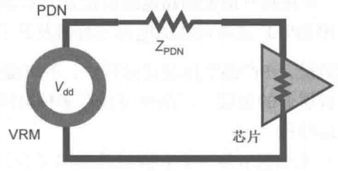

从片上焊盘看到的电源分配网络阻抗通常是频率相关的阻抗 $Z_{PDN}(f)$，当具有一定频谱宽度的波动电流通过电源分配网络的阻抗时，电源分配网络上会产生压降：
$$
\Delta U(f) = Z_{PDN}(f) \Delta I(f)
$$
$\Delta U(f)$ 是片上焊盘看到的电源分配网络阻抗，是频率的函数；$\Delta I(f)$ 是芯片消耗电流的频谱。

> 电源分配网络阻抗包含以下三部分：
>
> 1. 电阻压降
>    $$
>    \Delta U_R = \Delta IR
>    $$
>    负载电流增加时，电阻压降会增加，导致芯片侧供电电压下降；
>
> 2. 电感压降
>    $$
>    \Delta U_L = L\frac{\Delta I}{\Delta t}
>    $$
>    电流变化比较快时，很小的回路电感也可以导致明显的瞬态电压；
>
> 3. 电容缓冲
>    $$
>    \Delta U_c = \frac{\Delta I\Delta t}{C}
>    $$
>    电容可以在一段时间内缓冲负载电流变化。

---

**目标阻抗：**

假设允许的瞬态电压偏差为 $\Delta U_{ripple}$，负载电流变化 $\Delta I$，则目标阻抗定义为：
$$
Z_{target}(f) = \frac{\Delta U_{ripple}}{\Delta I(f)} > Z_{PDN}(f)
$$
从芯片焊盘端看到的电源分配网络的阻抗应当小于目标阻抗。一般使用瞬态电流峰值估计目标阻抗，如果无法获取瞬态峰值电流数据，应该使用芯片最大消耗电流进行粗略估计。

> 如果提供了芯片的最大消耗电流，则按照 50% 的最大消耗电流估算瞬态峰值电流；
>
> 如果提供了芯片的最大功耗，按照芯片供电电压计算芯片最大消耗电流。
>
> 也可以通过同时开关的门的数量计算瞬态峰值电流：$I_{tr} = n \frac{V_{CC}}{Z_0}$。假设每个门驱动的传输线特征阻抗为 $Z_0$。

一般认为目标阻抗在全频率范围内平坦。

## 2. PDN 的设计

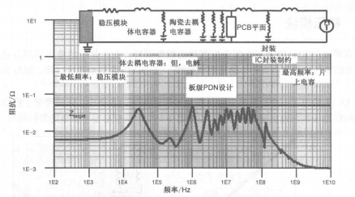

### 稳压器

稳压器决定了电源分配网络的低频阻抗。可以通过二端口阻抗分析仪测量稳压器的输出阻抗。

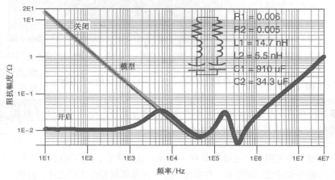

稳压器关闭时的输出阻抗特性近似为双电容的输出阻抗特性（一个大电容和一个小电容，存在两个谐振峰）。

稳压器开启时，由于闭环反馈（LDO 为负反馈电路，开关电源为模拟负反馈电路），低频输出阻抗会变低，稳压器的低频输出阻抗会更加平坦。频率升高时，稳压器的输出阻抗升高，直到稳压器对输出阻抗不起作用，输出阻抗由输出的电容决定。

稳压器的输出电容器容量可以通过稳压器不能维持低阻抗频率处的目标阻抗进行估算。
$$
C_{bulk} > \frac{1}{2\pi f Z_{target}}
$$
$f$ 一般取 1 kHz，表示此时稳压模块不再提供低阻抗。

低频时，稳压器可以等效为带电压源的 RL 电路。

### 片上电容

片上电容决定了最高频率时的电源分配网络阻抗。电源层和地层之间的电容，开关管的栅极电容，以及各类寄生电容。

片上电容会在高频时提供低的电源分配网络阻抗。

### 封装屏障

封装引脚回路电感串联在芯片焊盘到电路板焊盘之间。通常，低成本的引脚封装是一种基于密封引脚框架的封装/是一种基于双层印制电路板的封装。其相邻引脚的回路电感大概是 20 nH/in。在芯片尺寸封装中，一对引脚的电感能做到只有 2 nH 左右。在多层球栅阵列封装中，通常使用专门的电源/地平面。每个电源/地平面对的回电路可减小到不足 1 nH。在小型封装中，可能只有少数的电源/地平面对。而在大的球栅阵列封装中，则可能有数百个电源/地平面对。这样，封装引脚的有效电感可能会在 1 nH 到低至 1 pH 的范围内变化。

除了封装引脚电感，还有连到电路板上的过孔回路电感，以及在电源/地平面上运送电流过程中的扩散电感。当封装引脚电感很小时，过孔及扩散电感决定由芯片看过去的回路电感大小。

片上电容和封装电感会相互作用，产生并联谐振阻抗尖峰。**使用去耦电容可以抑制该阻抗尖峰**。

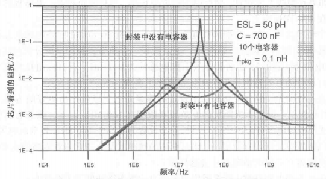

无论如何设计电源分配网络，不可能使得芯片看到的电源分配网络阻抗小于引脚封装阻抗。由此可以确定由引脚，过孔和杂散电感共同作用的阻抗开始超过目标阻抗的频率点，这是板上阻抗可以发挥作用的最高频率。

封装引脚电感，最高有效频率和目标阻抗之间的关系：
$$
Z_{target} < 2\pi L_{pkg}f_{max}
$$
$L_{pkg}$ 是封装内所有电源分配网络路径的等效引脚电感，$f_{max}$ 是板级电源分配网络的最高有效频率。根据此式可以确定某种目标阻抗的最高有效频率，同时也说明了引脚封装对电源分配网络性能的限制。

一般的，板级阻抗的最高有效频率往往低于 100 MHz。

封装引脚电感可以防止噪声从芯片传递到电路板上。

### 去耦电容

去耦电容可以用于**降低电源分配网络的阻抗**。通俗的说，**去耦电容可以抑制芯片引脚侧的电压波动，为芯片供电储存电荷**。

一般的，由于片上电容和稳压器的大容量稳压电容，使得电源分配网络通常可以正常工作。但是对于不同的应用场景（比如更换芯片和软件），同样的电路板可能产生不同的性能。同时通常难以获取芯片的引脚电感等寄生参数信息，因此需要设计板上去耦系统以适配不同的应用场景。通常根据最高频率和目标阻抗设计去耦系统。

---

***实际电容特性：***

实际电容的特性为 ESR（等效串联电阻），ESL（等效串联电感）和电容本体串联的特性：
$$
Z_C(f)=ESR + j(2\pi f ESL-\frac{1}{2\pi fC})
$$

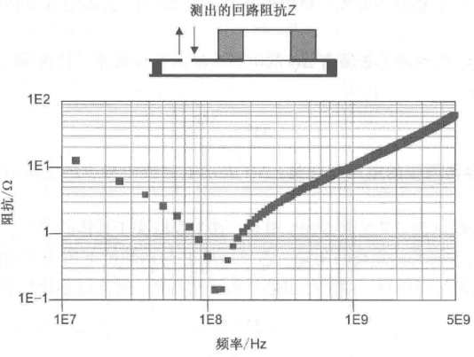

其中阻抗转折频率为自谐振频率：
$$
f_{SRF} = \frac{1}{2\pi \sqrt {LC}} \\

Z_C(f_{SRF}) = ESR
$$
高于自谐振频率时，频率越高，电源分配网络的阻抗越大。

对于实际的电容（高介电常数的 MLCC），施加直流电压后可能会导致电容下降。

---

***扩散电感：***

当电容并联在电源和地之间时，电容上的电流需要经过：电容器 - 电容焊盘及其连接 - 电源路径 - 负载连接 - 负载 - 返回路径。这部分的回路存在电感，该回路电感会影响电源分配网络的阻抗（影响等效串联电感）。

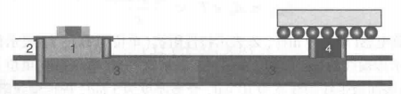

> 如图所示，与电容本身到封装路径有关的等效串联电感值可以划分为以下区段：
>
> 1. 表面走线与平面腔顶层的回路电感；
> 2. 从电容焊盘到腔平面过孔的回路电感；
> 3. 从电容器过孔到封装引脚的扩散电感；
> 4. 从封装下的平面腔到封装引脚的回路电感。
>
> 这部分的电感越大，自谐振频率越小，会导致高频时的电源网络阻抗变大。

- 电感的解析近似：

  假设电流的传输路径和返回路径在远端短路，任何均匀传输线的回路电感可以由下式给出：
  $$
  L_{loop} = Z_0\frac{l}{v}
  $$
  $Z_0$ 为特征阻抗，$l$ 为传输线长度，$v$ 为材料内的电磁波速度单位。

  双圆杆结构的回路电感可以通过下式给出，长度单位为 mil，电感单位为 pH：
  $$
  L_{loop} = 10h\ln\frac{2s}{D}
  $$

  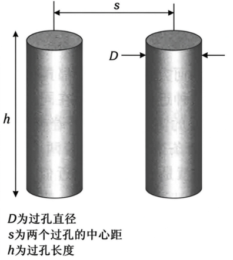

  两个平面间的回路电感可以通过下式给出，长度单位为 mil，电感单位为 pH：
  $$
  L_{loop} = 32h\frac{l}{w}
  $$

  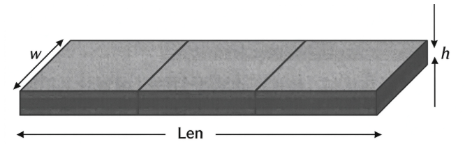

  > 这种假定电流在同质平面上从顶层回到底层的流动过程中沿着整个平面均匀分布。如果两条带状平面沿着两个边缘实现整体对接，这就是一个很好的近似。然而由于平面常常通过过孔实现连接，使电流不可能均匀流动。相反，由于过孔的限制，电流从源端扩散出去并在漏端再加以收缩。

  平面通过过孔实现相连时，接触点间在原有的平面电感值上还有额外的回路电感。

  单个过孔的扩散电感由下式给出，长度单位为 mil，电感单位为 pH：
  $$
  L_{spread} = 5.1h\ln\frac{b}{a}
  $$

  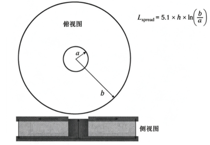

  两个过孔的扩散电感由下式给出，长度单位为 mil，电感单位为 pH：
  $$
  L_{spread} = 21h\ln\frac{B}{D}
  $$

  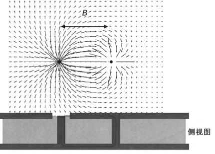

去耦电容的连接优化：

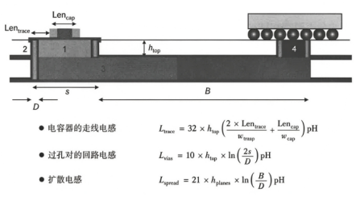

以下措施可以**减小去耦电容的回路电感**：

> - 电容焊盘到过孔的走线回路：**表层到电源/地平面的高度要短，表层走线应尽量宽，表层走线应尽量短**；
> - 过孔：表层到电源/地平面的高度要短，过孔孔径需要足够大，过孔间应尽量接近；
> - 回路扩散电感：电源/地平面间的介质厚度尽量薄，过孔孔径需要足够大，或者使用多过孔，电容器尽量靠近被去耦的封装。

因此，使得回路电感最低的放置位置就是去耦电容最好的放置位置。

根据扩散电感的计算公式可以得到去耦电容的有效作用范围，封装应当在该有效范围内。确定目标阻抗后，可以得到回路最大电感：
$$
L_{max} < \frac{Z_{target}}{2\pi f_{max}}
$$

---

**电容并联：**

多个相同的电容并联时，等效参数如下：
$$
C_n = nC \\
ESR_n = \frac{1}{n}ESR \\
ESL_n = \frac{1}{n}ESL
$$
多个相同的电容并联不会改变自谐振频率，阻抗曲线会下降。

两个容值不同的电容器并联时的阻抗曲线如下：

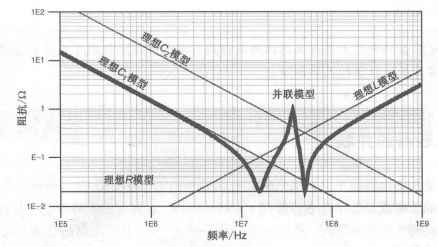

在两个电容的各自的自谐振频率时会发生低阻抗下冲，大电容的自谐振频率低，小电容的自谐振频率高。同时在两个自谐振频率之间存在并联谐振频率，该处会形成高阻抗。

如果两个电容器的自谐振频率相差较远，则并联谐振频率：
$$
PRF \approx \frac{1}{2\pi}\frac{1}{\sqrt{C_2 ESL_1}}, C_2 \ll C_1
$$

> 该式在自谐振频率值相差 10 倍以上时为近似式。

> - 小电容应该离封装更近以获得更高的自谐振频率，大电容可以离封装稍远一些。
> - 大电容的自谐振频率更低，通常抑制低频电压波动；小电容自谐振频率高，通常抑制高频电压波动。

并联谐振频率的阻抗峰值可估算为：
$$
Z_{peak} \approx \frac{L_1}{C_2}(\frac{1}{R_1+R_2})
$$
降低该峰值的途径是：

> - 减小大电容器的等效串联电感；
> - 增大小电容器的电容；
> - 增大两个电容器的等效串联电阻；

增加第三个电容器可以降低该谐振峰值，只需要这个电容器的自谐振频率和并联谐振频率一致，或者取这个电容的值是两个电容的几何平均值。

需要注意，低频时板上去耦电容会和稳压器电容发生作用。高频时板上去耦电容会和片上电容发生作用。

> - 低频可以使用更多的电容器并联降低稳压器电容带来的并联谐振阻抗峰值。电容选择和前述一致；
> - 高频通常需要加大接在平面上的电容值/减小平面电容/**减小去耦电容的电感**/增大电容器的 ESR/增加电容。

使用的电容器的最小个数取决于 ESL：
$$
n > 2\pi f_{max} \frac{ESL}{Z_{target}}
$$
$f_{max}$ 为板上去耦电容起效的最高频率（GHz），ESL 单位为 nH。
