# 传导耦合 滤波器

传导耦合指沿交流电源线耦合的电磁干扰，电气设备应当尽量减小对电网的**传导发射**，同时尽可能减小自身的**传导敏感度**。由于传导干扰沿交流电源线传递，因此通常使用滤波的方法减小传导发射并减小传导敏感度。

按照滤波器的能量损耗特性，滤波器可以分为反射式滤波器和吸收式滤波器；按照滤波器在电路中的位置，滤波器可以分为电源滤波器和信号滤波器。

## 1. 滤波器基本特性

在 EMI 中，滤波器性能通过插入损耗 $IL$ 衡量，假设未插入滤波器前的负载电压为 $\hat U_{L,w0}$，插入滤波器的负载电压为 $\hat{U_{L,w}}$，则插入损耗定义为：
$$
IL = 10 \log_{10}(\frac{P_{L,w0}}{P_{L,w}}) = 20\log_{10}(\frac{U_{L,w0}}{U_{L,w}}) 
$$
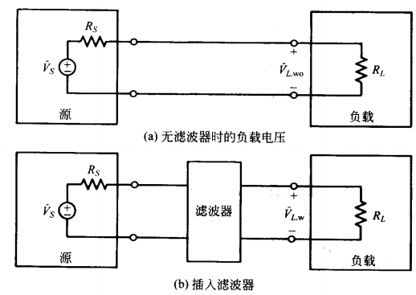

插入损耗是频率的函数，同时插入损耗不仅取决于滤波器内部参数，也取决于源阻抗和负载阻抗。以下是常见滤波器的插入损耗：

> 1. 电感型滤波器
>
>    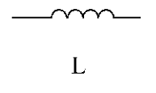
>    $$
>    IL = 10\log_{10}\left[1+\left(\frac{\omega L}{R_s+R_L}\right)^2\right]\ \mathrm{dB}
>    $$
>
> 2. 电容型滤波器
>
>    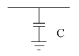
>    $$
>    IL 
>    = 10\log_{10}\left[1+\left(\omega C(R_s // R_L)\right)^2\right]\ \mathrm{dB}
>    $$
>
> 3. CL 型滤波器
>
>    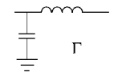
>    $$
>    IL = 10\log_{10}\left\{
>    \left[1-\frac{\omega^2 C R_s L}{R_s+R_L}\right]^2
>    +
>    \left[\frac{\omega(L+C R_sR_L)}{R_s+R_L}\right]^2
>    \right\}\ \mathrm{dB}
>    $$
>
> 4. LC 型滤波器
>
>    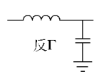
>    $$
>    IL = 10\log_{10}\left\{
>    \left[1-\frac{\omega^2 L C R_L}{R_s+R_L}\right]^2
>    +
>    \left[\frac{\omega(L+C R_sR_L)}{R_s+R_L}\right]^2
>    \right\}\ \mathrm{dB}
>    $$
>
> 5. LCL 型滤波器
>
>    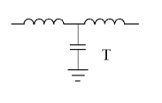
>    $$
>    IL = 10\log_{10}\left\{
>    \left[1-\frac{\omega^2 C(R_L L_1+R_s L_2)}{R_s+R_L}\right]^2
>    +
>    \left[\frac{\omega(L_1+L_2+C R_sR_L)-\omega^3 C L_1L_2}{R_s+R_L}\right]^2
>    \right\}\ \mathrm{dB}
>    $$
>
> 6. CLC 型滤波器
>
>    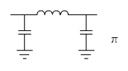
>    $$
>    IL = 10\log_{10}\left\{
>    \left[1-\frac{\omega^2 L(R_L C_2+R_s C_1)}{R_s+R_L}\right]^2
>    +
>    \left[\frac{\omega\left(L+R_sR_L(C_1+C_2)\right)-\omega^3 L C_1C_2R_sR_L}{R_s+R_L}\right]^2
>    \right\}\ \mathrm{dB}
>    $$

---

**阻抗失配：**

滤波器的插入损耗受到源阻抗和输出阻抗的影响，通常这两者是任意的，无法满足滤波器处于最优的滤波状态。

滤波器视为二端口网络，其传输参数方程如下：
$$
\begin{cases}
U_1 = A_{11}U_2 - A_{12}I_2 \\
I_1 = A_{21}U_2 - A_{22}I_2
\end{cases}
$$
输入阻抗和输出阻抗定义如下：
$$
Z_{1i} = \frac{U_1}{I_1} = \frac{A_{12} + A_{11}Z_L}{A_{22} + A_{21}Z_L} \\
Z_{2i} = \frac{U_2}{I_2} = \frac{A_{21} + A_{22}Z_S}{A_{11} + A_{12}Z_S}
$$
当 $Z_S$ ($Z_L$) 较高时，使用较低的 $Z_{1i}$($Z_{2i}$) 可以通过低阻抗通路进行电流分流；当 $Z_S$ ($Z_L$) 较低时，使用较高的 $Z_{1i}$($Z_{2i}$) 可以使用高阻抗通路抑制电流。

因此，如果负载阻抗(源阻抗)较高，使用并联电容的方式进行滤波；如果负载阻抗(源阻抗)较低，使用串联电感的方式进行滤波。此时可以设计滤波器结构。

## 2. 电源滤波器

典型的电源滤波器结构如图所示：

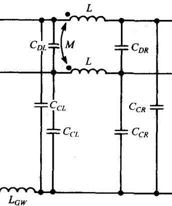

> 相线和零线之间的电容是 X 电容（$C_{DL}$，$C_{DR}$）。X 电容用于分流差模电流。
>
> 相线/零线和地线之间的电容是 Y 电容（$C_{CL}$，$C_{CR}$）。Y 电容用于分流共模电流，Y 电容受到最大漏电流的限制，通常不会取很大的值。
>
> 相线和零线上串联共模扼流圈以抑制共模电流，地线上串联电感 $L_{GW}$ 也可以抑制共模电流。

共模电流等效电路如下，等效于 CLC 滤波器：

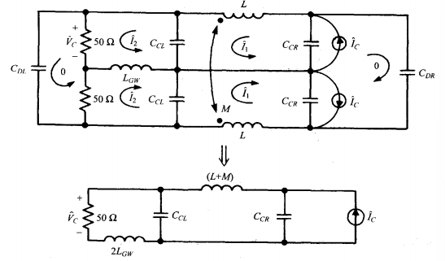

差模电流等效电路如下：

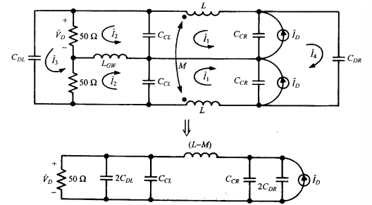

---

**电源滤波器的安装位置：**

1. 滤波器应尽量安装在设备的入口/出口处，未经处理的电源线在机内走线不宜过长，防止产生辐射；通常使用插座式滤波器，使得其进出线位于机箱内外两侧。

   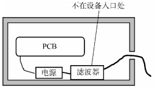

2. 滤波器输入和输出引线应当隔离，如果不能应当使用屏蔽线。

   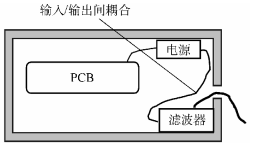

3. 滤波器不宜用细长导线接地，应保持滤波器的地与设备外壳有一个大的导电接触面以保证良好接地，同时设备外壳必须接大地。

   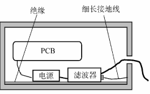

因此滤波器的正确安装方式如下：

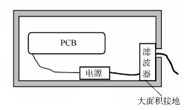
