# 辐射耦合 屏蔽

屏蔽指利用屏蔽体阻断或者减小电磁能量在空间传播的技术。屏蔽的目的包括：限制内部产生的辐射超出一定强度；防止外来辐射耦合到内部。屏蔽通常是将产品一部分封到金属外壳内。

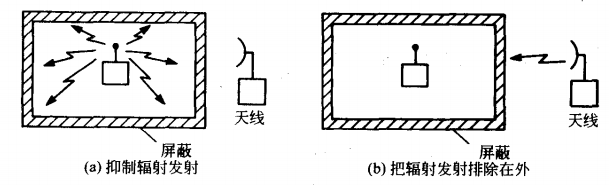

## 1. 屏蔽效能

屏蔽效能定义为未加入屏蔽时某一点的电磁场强($E_0$，$H_0$)与加入屏蔽后某一点的电磁场强($E_s$，$H_s$)之比：
$$
SE_E = 20\log\frac{E_0}{E_s} \\
SE_H = 20\log\frac{H_0}{H_s}
$$
屏蔽效能越大，屏蔽效果越好。

> 如下图：
>
> 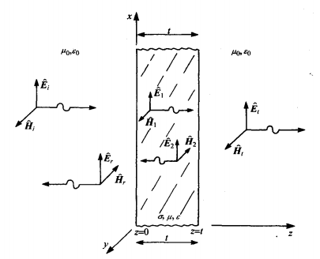
>
> $E_i$，$H_i$ 为入射电磁场，$E_t$，$H_t$ 为透射电磁场，$E_r$，$H_r$ 为反射电磁场。一般定义：
> $$
> SE_E = 20\log\frac{E_i}{E_t} \\
> SE_H = 20\log\frac{H_i}{H_t}
> $$
> 若入射场为均匀平面波(远场)且两侧介质一致，则 $SE_E$ 和 $SE_H$ 结果一致(电磁波特性阻抗)；如果入射场为近场或者边界两侧介质不一致，则 $SE_E$ 和 $SE_H$ 结果不一致。
>
> 入射场穿过屏蔽体时，首先会发生屏蔽体左表面的反射，入射波被反射的部分由该表面的反射系数决定。穿过该表面的电磁波穿过屏蔽体，其幅值发生衰减，然后成为右表面的入射波，一部分被反射，另一部分透射进入右侧介质，如此重复：
>
> 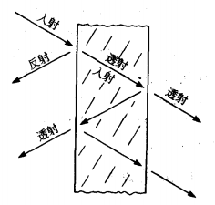
>
> 电磁波在屏蔽体内传播时，其幅值会发生衰减，衰减因子为 $e^{-\alpha z}$，屏蔽体为良导体时：$\alpha = \frac{1}{\delta}$，如果屏蔽体厚度远大于趋肤深度，则屏蔽体内部反射次数很少，因此一般不计算多次反射和透射，只需要考虑左右表面的初始反射和透射。
>
> 屏蔽效能可以分为三项乘积：
> $$
> SE = R +A+M
> $$
> $R$ 为左右表面反射引起的反射损耗；$A$ 为电磁波穿过屏蔽体式的吸收损耗；$M$ 为多次反射和透射因子，一般会降低屏蔽效能。

## 2. 电磁场屏蔽

### 远场屏蔽

假设入射场场源足够远使得入射波为均匀平面波。屏蔽体厚度为 $t$，电导率为 $\sigma$，相对介电常数为 $\epsilon$，相对磁导率为 $\mu$。两侧介质为自由空间。因此相关场的一般形式为：
$$
\hat{\mathbf{E}}_i = \hat E_ie^{-j\beta_0z}\mathbf{e}_x \\
\hat{\mathbf{H}}_i = \frac{\hat E_i}{\eta_0}e^{-j\beta_0z}\mathbf{e}_y \\
\hat{\mathbf{E}}_r = \hat E_re^{-j\beta_0z}\mathbf{e}_x \\
\hat{\mathbf{H}}_r = \frac{\hat E_r}{\eta_0}e^{-j\beta_0z}\mathbf{e}_y \\
\hat{\mathbf{E}}_1 = \hat E_1e^{-\hat{\gamma}z}\mathbf{e}_x \\
\hat{\mathbf{H}}_1 = \frac{\hat E_1}{\hat{\eta}}e^{-\hat{\gamma}z}\mathbf{e}_y \\
\hat{\mathbf{E}}_2 = \hat E_2e^{\hat{\gamma}z}\mathbf{e}_x \\
\hat{\mathbf{H}}_2 = -\frac{\hat E_2}{\hat{\eta}}e^{\hat{\gamma}z}\mathbf{e}_y \\
\hat{\mathbf{E}}_t = \hat E_te^{-j\beta_0z}\mathbf{e}_x \\
\hat{\mathbf{H}}_t = \frac{\hat E_t}{\eta_0}e^{-j\beta_0z}\mathbf{e}_y \\
$$
$\hat\gamma$ 为均匀介质中的传播常数，$\hat\gamma = \sqrt{j\omega\mu(\sigma+j\omega\epsilon)}=\alpha+j\beta$；$\hat\eta$ 为均匀介质中的特征阻抗，$\hat\eta = \sqrt{\frac{j\omega\mu}{\sigma+j\omega\epsilon}}$；$\alpha$ 为衰减常数，$\beta$ 为相位常数，无损耗介质中 $\alpha = 0$。

入射场的幅值已知，需要边界条件求解剩余场的幅值，根据边界条件：电场切向分量连续，磁场切向分量连续：
$$
\hat{\mathbf{E}}_i|_{z=0}+\hat{\mathbf{E}}_r|_{z=0}=\hat{\mathbf{E}}_1|_{z=0}+\hat{\mathbf{E}}_2|_{z=0} \\
\hat{\mathbf{E}}_1|_{z=t}+\hat{\mathbf{E}}_2|_{z=t}=\hat{\mathbf{E}}_t|_{z=t} \\
\hat{\mathbf{H}}_i|_{z=0}+\hat{\mathbf{H}}_r|_{z=0}=\hat{\mathbf{H}}_1|_{z=0}+\hat{\mathbf{H}}_2|_{z=0} \\
\hat{\mathbf{H}}_1|_{z=t}+\hat{\mathbf{H}}_2|_{z=t}=\hat{\mathbf{H}}_t|_{z=t}
$$
得到：
$$
\frac{E_i}{E_t} = \frac{(\eta_0+\hat\eta)^2}{4\eta_0\hat\eta}[1-(\frac{\eta_0-\hat\eta}{\eta_0+\hat\eta})e^{-2t/\delta}e^{-j2\beta t}]e^{t/\delta}e^{j\beta t}e^{-j\beta_0t}
$$
为精确解。

假设屏蔽体由良导体构成，因此导体的特性阻抗远小于自由空间特性阻抗：$\frac{\eta_0-\hat\eta}{\eta_0+\hat\eta}\approx1$；假设趋肤深度远小于屏蔽体厚度：$e^{-\hat{\gamma}t}=e^{-\alpha t}e^{-j\beta t} \ll 1$；则：

$$
SE \approx 20\log|\frac{\eta_0}{4\hat{\eta}}|+20\log e^{t/\delta}+M
$$
第一项为反射损耗，第二项为吸收损耗，第三项为多次反射损耗：
$$
M=|1-(\frac{\eta_0-\hat\eta}{\eta_0+\hat\eta})e^{-2t/\delta}e^{-j2\beta t}|\approx20\log|1-e^{-2t/\delta}e^{-j2t/\delta}|
$$

---

**近似解：**

假设屏蔽体由良导体构成，趋肤深度远小于屏蔽体厚度，因此在屏蔽体内部的衰减比较大，可以假设左表面 $\hat E_2 = 0$。

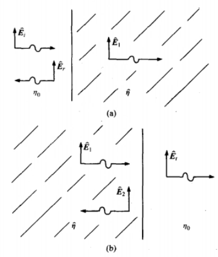

左表面的透射系数：
$$
\frac{\hat E_1}{\hat E_i} \approx \frac{2\hat \eta}{\eta_0 + \eta}
$$
右表面的透射系数：
$$
\frac{\hat E_t}{\hat E_1} \approx \frac{2\eta_0}{\eta_0 + \eta}
$$
因此可以得到透射场和入射场的比：
$$
\frac{\hat E_t}{\hat E_i} \approx \frac{4\hat \eta \eta_0}{(\eta_0 + \hat\eta)^2}
$$
考虑到 $\hat \eta \ll \eta$​，在第一个边界处透射系数很小，第二边界处近似为 2。穿透第一边界的电场很小，反射系数为 $\Gamma_1 \approx -1$，电场被良导体有效短路；第二边界的反射系数为 $\Gamma_2 \approx 1$，入射的电场大部分被反射，类似于传输线开路。

反射损耗：
$$
R = 20\log|\frac{\hat E_i}{\hat E_t} | \approx 20\log|\frac{\eta_0}{4\hat\eta}|
$$
对于磁场，左表面的透射系数：
$$
\frac{\hat H_1}{\hat H_i} = \frac{\frac{\hat E_1}{\hat \eta}}{\frac{\hat E_i}{\eta_0}}\approx \frac{2\eta_0}{\eta_0 + \eta} \\
$$
右表面的透射系数：
$$
\frac{\hat H_t}{\hat H_1} = \frac{\frac{\hat E_t}{\eta_0}}{\frac{\hat E_1}{\hat\eta}}\approx \frac{2\hat \eta}{\eta_0 + \eta}
$$
磁场的总透射系数和电场的总透射系数一致，然而，**磁场的透射主要发生在第一边界，电场的透射主要发生在第二边界**。当磁场穿过边界时的衰减词比电场的衰减重要。这表明**屏蔽体厚度更厚对磁场的屏蔽比对电场的屏蔽更有效**。厚的屏蔽体才能有效屏蔽磁场，而薄的屏蔽体即可有效屏蔽电场。

计算反射损耗时假设 $\hat E_1$ 在左表面和右表面幅值一致。但是实际上电场到达右表面时幅值会发生衰减，吸收损耗为：
$$
A = 20\log e^{t/\delta}
$$
多次反射因子可以在每个表面上计算反射系数得出，其结果已经在精确解中给出，频率越低，趋肤深度越大，需要考虑多次反射因子带来的不利影响：

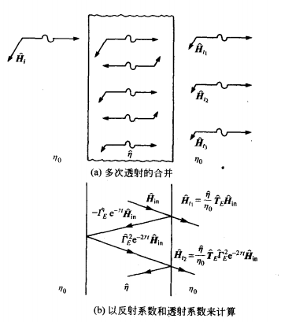

---

**总损耗：**

假设屏蔽体为良导体，则：
$$
R = 20\log(\frac{1}{4}\sqrt{\frac{\sigma}{\omega\mu_r\epsilon_0}}) = 168 + 10\log\frac{\sigma_r}{\mu_r f}
$$
$\sigma_r$​ 为相对于铜的电导率。**高电导率的金属在低频时的反射损耗最大**。反射损耗随频率以 -10dB/10倍频 的强度衰减。

吸收损耗可计算为：
$$
A = 131.4t\sqrt{f\mu_r\sigma_r}
$$
**高电导率的金属在高频时的吸收损耗最大**。吸收损耗随频率以 10dB/10倍频 的强度增加。同时，屏蔽层相对于趋肤深度越厚，吸收损耗越高。

### 近场屏蔽

近场源产生的电磁波并不是平面波。

对于电偶极子源(电场源)：
$$
\hat E_\theta \propto \frac{1}{r^3} \\
\hat H_\phi \propto \frac{1}{r^2} \\
|Z_w| = \frac{1}{2\pi f\epsilon_0r}
$$
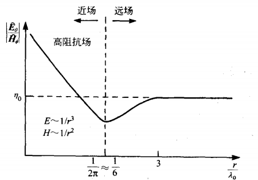

对于磁偶极子源(磁场源)：
$$
\hat H_\theta \propto \frac{1}{r^3} \\
\hat E_\phi \propto \frac{1}{r^2} \\
|Z_w| = {2\pi f\mu_0r}
$$
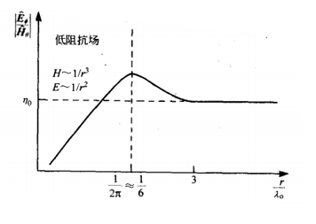

变压器发出的辐射是磁场源辐射；火花和电弧发生点发出的辐射是电场源辐射。

近场源的类型决定了有效屏蔽方法，作为近似，将波阻抗替代自由空间特征阻抗进行屏蔽效能分析。

**吸收损耗和源的类型无关。**

对于电场源：
$$
R\approx20\log|\frac{\hat Z_w}{4\hat\eta}| \approx 322+10\log\frac{\sigma_r}{\mu_rf^3r^2}
$$
**近场电场源的反射损耗远大于均匀平面波源的反射损耗，也随着源和屏蔽体之间距离的减小而增大**。

对于磁场源：
$$
R\approx20\log|\frac{\hat Z_w}{4\hat\eta}| \approx 14.56+10\log(\frac{fr^2\sigma_r}{\mu_r})
$$
**近场磁场源的反射损耗随频率的降低而减小，同时小于平面波的反射损耗，也随着源和屏蔽体之间距离的减小而减小**。

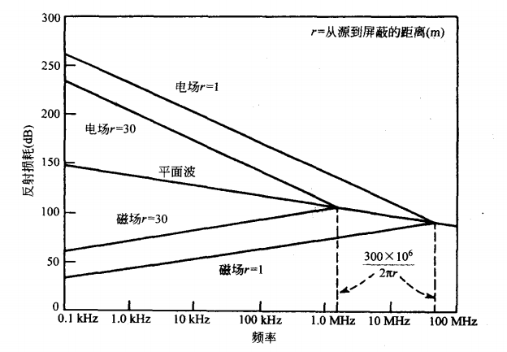

> **低频磁场屏蔽**：
>
> 近场磁场源下，吸收损耗占主要部分，但是低频下反射损耗和吸收损耗都很小，需要使用其他方法进行屏蔽。
>
> 1. **使用高磁导率材料分流磁通**
>
>    假设外部介质是自由空间 $\mu_0$，屏蔽体由导磁率为 $\mu_r \gg 1$ 的铁磁性材料构成，磁场将被集中在低磁阻通路内，因此从屏蔽体内部被影响的区域分流。但是需要注意：
>
>    - 铁磁性材料的磁导率随频率的升高而降低；
>    - 铁磁性材科的磁导率随磁场场强的增加而降低。（磁饱和）
>
>    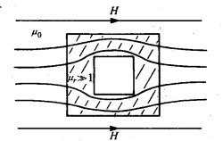
>
>    一般对于频率较高的磁场，使用钢外壳有效性大于使用高磁导率材料：
>
>    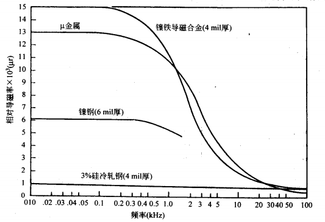
>
>    对于频率较低的磁场，生成这种磁场的电流通常比较大(比如工频电流)，容易造成饱和。通常采用双层屏蔽：第一层使用低磁导率材料减小入射磁场防止饱和(同时反射电场)，第二层使用高磁导率材料。
>
> 2. **通过电磁感应产生反向磁通**
>
>    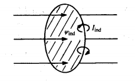
>
>    放置如导线等导电环使磁场穿过导电环所包围的面。此时在导电环中感应出感应电流，感应电流产生的磁通和入射磁通相反。
>
>    使用该方法的要点是环的放置要使环所包面的面尽可能与要消除的磁通相互垂直，以使环带中感应出最大的电动势。有些情况必须使用两个正交短环带。
>
>    对于静磁场，该方法无效。

> **电场屏蔽：**
>
> 使用导体对器件进行包围可以有效减小电场辐射，但是需要注意，无论对于静电场还是对于交变电场，屏蔽体必须等电位(接地)以使得电场线全部终止到屏蔽体上实现良好屏蔽，否则将不会起到屏蔽效果。

## 3. 开孔

屏蔽体是通过电磁感应的方式产生反射场的，为了使得屏蔽体有效的产生反射场，必须为感应电流提供低阻抗通路，和感应电流方向垂直的缝隙会显著提高感应电流通路的阻抗，减小屏蔽效能。如果缝隙沿着感应电流通路方向布置，则缝隙对屏蔽几乎没有影响。但是感应电流的方向不容易判断，通常用一堆小孔替代长缝隙。

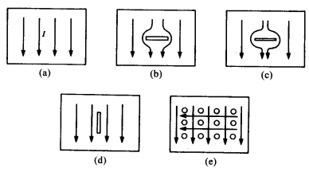

同时针对于门/盖子的缝隙，缝隙的长度影响显著大于宽度，如果缝隙长度接近半波长度，则缝隙的辐射电平类似于半波偶极子天线。通常需要很密集的沿着盖子设计螺孔以破坏潜在天线，短天线的辐射效率低于长天线。同时金属垫圈可以用于填充缝隙，比如金属编织网。垫圈通常放在螺孔内部以防护螺孔的辐射。

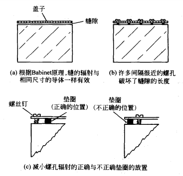

### 波导

波导是用于引导电磁波在有限空间中传播的结构，常见的波导如下：

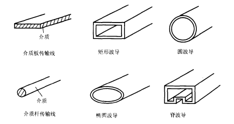

---

**导行电磁波：**

一般定义 $z$ 轴为波导轴线，波导横截面是 $xOy$ 平面，并假设：

1. 波导的横截面形状和介质特性沿着轴线 $z$ 不变化（轴向均匀）；
2. 金属波导为理想导体，$\gamma = \infin$，波导内填充均匀，线性，各向同性的理想介质；
3. 波导内部无激励源，$\rho = 0$，$\mathbf J = 0$；
4. 电磁波沿 $z$ 轴传播且场随时间正弦变化。

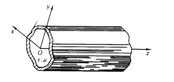

此时 Maxwell 方程：
$$
\nabla \times \dot{\mathbf H}=j\omega\epsilon\dot{\mathbf{E}} \\
\nabla \times \dot{\mathbf E}=-j\omega\mu\dot{\mathbf{H}} \\
\nabla \cdot \dot{\mathbf H}=0 \\
\nabla \cdot \dot{\mathbf E}=0
$$
则电磁场的电场分量和磁场分量满足齐次波动方程：
$$
\nabla^2\dot{\mathbf E}+k^2\dot{\mathbf E}=0 \\
\nabla^2\dot{\mathbf H}+k^2\dot{\mathbf H}=0
$$
$k = \omega\sqrt{\mu\epsilon}$ 为波数。

波导内部的传播情况无论如何复杂，整体上仍然显示为沿着 $z$ 方向前进的导行电磁波。
$$
\dot{\mathbf E} = \mathbf E(x,y)e^{-\gamma z} \\
\dot{\mathbf H} = \mathbf H(x,y)e^{-\gamma z}
$$
代入波动方程：
$$
\nabla^2_t \mathbf E(x,y)+k_c^2\mathbf E(x,y)=0 \\
\nabla^2_t \mathbf H(x,y)+k_c^2\mathbf H(x,y)=0
$$
$\nabla_t^2 = \frac{\partial^2}{\partial x^2}+\frac{\partial^2}{\partial y^2}$，$k_c^2 = k^2+\gamma^2$。

由此可得：
$$
\frac{\partial^2 E_z}{\partial x^2} + \frac{\partial^2 E_z}{\partial y^2} + k_c^2 E_z = 0 \\
\frac{\partial^2 H_z}{\partial x^2} + \frac{\partial^2 H_z}{\partial y^2} + k_c^2 H_z = 0 
$$
由旋度方程可以得到：
$$
\begin{aligned}
E_x &= -\frac{1}{k_c^2} \left( \gamma \frac{\partial E_z}{\partial x} + j\omega\mu \frac{\partial H_z}{\partial y} \right) \\[1ex]
E_y &= \frac{1}{k_c^2} \left( -\gamma \frac{\partial E_z}{\partial y} + j\omega\mu \frac{\partial H_z}{\partial x} \right) \\[1ex]
H_x &= \frac{1}{k_c^2} \left( j\omega\varepsilon \frac{\partial E_z}{\partial y} - \gamma \frac{\partial H_z}{\partial x} \right) \\[1ex]
H_y &= -\frac{1}{k_c^2} \left( j\omega\varepsilon \frac{\partial E_z}{\partial x} + \gamma \frac{\partial H_z}{\partial y} \right)
\end{aligned}
$$
波导中的导行电磁波可能有 $E_z$ 和 $H_z$ 分量，因此可以根据 $E_z$ 和 $H_z$ 的存在情况，分为三种波型：TEM 波，TE 波和 TM 波。

1. TEM 波 - 横电磁波：$E_z = 0$，$H_z = 0$。

   只有当 $k_c = 0$ 时，横向分量不为 0，则 $\gamma^2 = -k^2$。因此 $\gamma = jk = j\omega\sqrt{\mu\epsilon}$。

   此时波动方程： 
   $$
   \nabla^2_t \mathbf E(x,y)=0 \\
   \nabla^2_t \mathbf H(x,y)=0
   $$

   为 Laplace 方程。

   因此导波系统中的 TEM 波在横截面上的场分量满足 Laplace 方程，因此其分布与静态场中相同边界条件下的场分布相同。因此为了传输 TEM 波，必须有两个以上导体。

2. TE 波 - 横电波：$E_z = 0$，$H_z ≠ 0$。

   $H_z$ 满足波动方程，在金属导体内壁的边界条件为：
   $$
   \frac{\partial H_z}{\partial n}|_s = 0
   $$
   只有在 $k_c$ 取特定的值(本征值)时才有解。

3. TM 波 - 横磁波：$E_z ≠ 0$，$H_z = 0$。

   $E_z$ 满足波动方程，在金属导体内壁的边界条件为：
   $$
   E_z|_s = 0
   $$
   只有在 $k_c$ 取特定的值(本征值)时才有解。

对于 TE/TM 波，
$$
\gamma = 
\begin{cases} 
j\sqrt{k^2 - k_c^2} = j\beta & k > k_c \\[1.5ex]
\sqrt{k_c^2 - k^2} = \alpha & k < k_c 
\end{cases}
$$
$k>k_c$ 时，波沿 $z$ 方向传播，称为传播模式；$k<k_c$ 时，波导内没有波的传播，称为衰落模式，$k=k_c$ 时的频率为截止频率：
$$
f_c = \frac{k_c}{2\pi\sqrt{\mu\epsilon}}
$$
波导的本征值决定了截止频率，波导相当于高通滤波器，$f>f_c$ 时，电磁波才能在波导内传播。

对于 TEM 波，没有截止频率，因此 TEM 波的导波系统可以传播全频段的电磁波。

---

**矩形波导：**

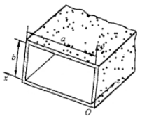

矩形波导不能传播 TEM 波。

1. TM 波的传播：

   TM 波场方程：
   $$
   \begin{aligned}
   &\frac{\partial^2 E_z}{\partial x^2} + \frac{\partial^2 E_z}{\partial y^2} + k_c^2 E_z = 0 \\[1.5ex]
   &E_z \big|_{x=0} = E_z \big|_{x=a} = 0 \\[1.5ex]
   &E_z \big|_{y=0} = E_z \big|_{y=b} = 0
   \end{aligned}
   $$
   其解为：
   $$
   \begin{aligned}
   E_z &= A_{mn} \sin \left( \frac{m\pi}{a}x \right) \sin \left( \frac{n\pi}{b}y \right) \\[1.5ex]
   k_c^2 &= k_{mn}^2 = \left( \frac{m\pi}{a} \right)^2 + \left( \frac{n\pi}{b} \right)^2
   \end{aligned}
   $$
   其余场分量：
   $$
   \begin{aligned}
   E_x &= -\frac{\gamma}{k_c^2} \left( \frac{m\pi}{a} \right) A_{mn} \cos \left( \frac{m\pi}{a}x \right) \sin \left( \frac{n\pi}{b}y \right) \\[1.5ex]
   E_y &= -\frac{\gamma}{k_c^2} \left( \frac{n\pi}{b} \right) A_{mn} \sin \left( \frac{m\pi}{a}x \right) \cos \left( \frac{n\pi}{b}y \right) \\[1.5ex]
   H_x &= \frac{j\omega\varepsilon}{k_c^2} \left( \frac{n\pi}{b} \right) A_{mn} \sin \left( \frac{m\pi}{a}x \right) \cos \left( \frac{n\pi}{b}y \right) \\[1.5ex]
   H_y &= -\frac{j\omega\varepsilon}{k_c^2} \left( \frac{m\pi}{a} \right) A_{mn} \cos \left( \frac{m\pi}{a}x \right) \sin \left( \frac{n\pi}{b}y \right)
   \end{aligned}
   $$

2. TE 波的传播：

   TE 波场方程：
   $$
   \begin{aligned}
   &\frac{\partial^2 H_z}{\partial x^2} + \frac{\partial^2 H_z}{\partial y^2} + k_c^2 H_z = 0 \\[1.5ex]
   &\left. \frac{\partial H_z}{\partial y} \right|_{x=0} = \left. \frac{\partial H_z}{\partial y} \right|_{x=a} = 0 \\[1.5ex]
   &\left. \frac{\partial H_z}{\partial x} \right|_{y=0} = \left. \frac{\partial H_z}{\partial x} \right|_{y=b} = 0
   \end{aligned}
   $$
   其解为：
   $$
   \begin{aligned}
   H_z &= A_{mn} \cos \left( \frac{m\pi}{a}x \right) \cos \left( \frac{n\pi}{b}y \right) \\[1.5ex]
   k_c^2 &= k_{mn}^2 = \left( \frac{m\pi}{a} \right)^2 + \left( \frac{n\pi}{b} \right)^2
   \end{aligned}
   $$
   其余场分量：
   $$
   \begin{aligned}
   E_x &= \frac{j\omega\mu}{k_c^2} \left( \frac{n\pi}{b} \right) A_{mn} \cos \left( \frac{m\pi}{a}x \right) \sin \left( \frac{n\pi}{b}y \right) \\[1.5ex]
   E_y &= -\frac{j\omega\mu}{k_c^2} \left( \frac{m\pi}{a} \right) A_{mn} \sin \left( \frac{m\pi}{a}x \right) \cos \left( \frac{n\pi}{b}y \right) \\[1.5ex]
   H_x &= \frac{\gamma}{k_c^2} \left( \frac{m\pi}{a} \right) A_{mn} \sin \left( \frac{m\pi}{a}x \right) \cos \left( \frac{n\pi}{b}y \right) \\[1.5ex]
   H_y &= \frac{\gamma}{k_c^2} \left( \frac{n\pi}{b} \right) A_{mn} \cos \left( \frac{m\pi}{a}x \right) \sin \left( \frac{n\pi}{b}y \right)
   \end{aligned}
   $$

在波导的横截面上，场按照正弦变化，分布情况取决于 $m$ 和 $n$ 的取值。取不同的 $m$ 和 $n$ 值有不同场分布，称为不同的模式：$TE_{nm}$ 模/$TM_{nm}$ 模。

截止频率为：
$$
f_c = \frac{1}{2\sqrt{\mu\epsilon}}\sqrt{(\frac{m}{a})^2+(\frac{n}{b})^2}
$$
不同的模式可以有相同的截止频率，称为简并现象，发生简并的模式为简并模式。除了 $TE_{0n}$ 和 $TM_{0n}$ 模，其余的 TE 和 TM 模式都是简并的。

矩形波导可以工作在多模状态或者单模状态。$TE_{10}$ 模和 $TM_{11}$ 模有最低的截止频率。$TE_{10}$ 模的截止频率最低，因此称为主模。

一般要求波导工作在单模状态，因此使用 $TE_{10}$ 模进行能量传输。如果工作波长大于 $2a$，电磁波不能传播；如果工作波长小于 $a$，至少会出现两种模。

$b/a = 1$ 时，存在简并，因此不宜用作信息传输；$b/a = 1/2$ 时，在 $a < \lambda <2a$ 内只能传输 $TE_{10}$ 模，当 $b/a > 1/2$ 时，可传输的单模范围变窄，当 $b/a < 1/2$ 时，$b$ 越小，导体损耗越大，因此使用 $b/a = 1/2$ 的尺寸传输能量。

---

**介质波导：**

假设平板介质的介电常数为 $\epsilon$，介质板的厚度为 $2d$，沿 $yz$ 方向无限延伸，假设电磁波沿 $z$ 传播，并且在 $y$ 方向均匀。

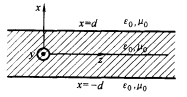
$$
\begin{aligned}
&\frac{d^2 E_z(x)}{dx^2} + k_c^2 E_z(x) = 0 \\[1.5ex]
&\frac{d^2 H_z(x)}{dx^2} + k_c^2 H_z(x) = 0
\end{aligned}
$$
考虑 $|x|>d$ 时，电磁波在自由空间中沿 $x$ 方向随着离开板的距离增加而衰减，因此 $k_c^2$ 为负实数：
$$
k_c^2 = \omega^2\mu_0\epsilon_0+\gamma^2 = -k_1^2
$$
$|x|<d$ 时，则：
$$
k_c^2 = \omega^2\mu_0\epsilon+\gamma^2=k_2^2
$$
解：
$$
\begin{aligned}
E_z(x) &= \begin{cases} 
A e^{-k_1 |x|} & (|x| > d) \\
C_1 \sin k_2 x + C_2 \cos k_2 x & (|x| < d)
\end{cases} \\[2ex]
H_z(x) &= \begin{cases} 
B e^{-k_1 |x|} & (|x| > d) \\
D_1 \sin k_2 x + D_2 \cos k_2 x & (|x| < d)
\end{cases}
\end{aligned}
$$

1. TE 波

   $H_z$ 沿 $x$ 方向有两种驻波：一类为 $\cos k_2x$，另一类为 $\sin k_2x$。称为偶模和奇模。

   对于偶模，根据边界条件可得 $k_1$ 和 $k_2$ 关系：
   $$
   k_1d = -k_2d\cot k_2d \\
   (k_2d)^2+(k_1d)^2=(\omega d)^2\mu_0(\epsilon-\epsilon_0)
   $$
   对于奇模，根据边界条件可得 $k_1$ 和 $k_2$ 关系：
   $$
   k_1d = k_2d\tan k_2d \\
   (k_2d)^2+(k_1d)^2=(\omega d)^2\mu_0(\epsilon-\epsilon_0)
   $$
   TE 波也有不同的传播模式，频率越高，可用的传播模式越多。

   截止频率：
   $$
   f_c = \begin{cases} 
   \displaystyle \frac{2n + 1}{4d \sqrt{\mu_0 (\varepsilon - \varepsilon_0)}} & (\text{偶模}), \quad n = 0, 1, 2, \cdots \\[3ex]
   \displaystyle \frac{2n}{4d \sqrt{\mu_0 (\varepsilon - \varepsilon_0)}} & (\text{奇模}), \quad n = 0, 1, 2, \cdots
   \end{cases}
   $$
   截止频率以下并不是不能传播，而是衰减传播，衰减的能量转化为辐射。

2. TM 波
   $$
   k_1 d = \begin{cases} 
   -\dfrac{\varepsilon_0}{\varepsilon} k_2 d \cot k_2 d & (\text{偶模}) \\[3ex]
   \dfrac{\varepsilon_0}{\varepsilon} k_2 d \tan k_2 d & (\text{奇模})
   \end{cases} \\
   
   (k_2d)^2+(k_1d)^2=(\omega d)^2\mu_0(\epsilon-\epsilon_0)
   $$

---

**谐振腔：**

谐振腔是用理想导体围成的空腔，电磁振荡约束在空腔内部，无辐射和介质损耗。

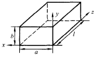

一段长 $l$ 的波导，两侧用金属板封闭，通过反射形成驻波，从而造成电磁振荡。考虑 $z$ 轴为传播方向。

1. TE 振荡：

   $z$ 方向有正方向波和反射的反方向波，将两个波合成可以得到 $H_z$ 的表达式：
   $$
   \dot{H}_z = \left( A^+ e^{-\mathrm{j}\beta z} + A^- e^{\mathrm{j}\beta z} \right) \cos \frac{m\pi x}{a} \cos \frac{n\pi y}{b}
   $$
   $A^+$ 和 $A^-$ 为正方向和反方向传播的振幅常数。注意 $z = 0$ 时 $\dot H_z = 0$；$z=l$ 时 $\dot H_z = 0$，则：
   $$
   \begin{aligned}
   \dot{E}_x &= \frac{2\omega\mu}{k_c^2} \left( \frac{n\pi}{b} \right) A^+ \cos \left( \frac{m\pi}{a}x \right) \sin \left( \frac{n\pi}{b}y \right) \sin \left( \frac{p\pi}{l}z \right) \\[1.5ex]
   \dot{E}_y &= -\frac{2\omega\mu}{k_c^2} \left( \frac{m\pi}{a} \right) A^+ \sin \left( \frac{m\pi}{a}x \right) \cos \left( \frac{n\pi}{b}y \right) \sin \left( \frac{p\pi}{l}z \right) \\[1.5ex]
   \dot{H}_x &= \frac{2j}{k_c^2} \left( \frac{m\pi}{a} \right) \left( \frac{p\pi}{l} \right) A^+ \sin \left( \frac{m\pi}{a}x \right) \cos \left( \frac{n\pi}{b}y \right) \cos \left( \frac{p\pi}{l}z \right) \\[1.5ex]
   \dot{H}_y &= \frac{2j}{k_c^2} \left( \frac{n\pi}{b} \right) \left( \frac{p\pi}{l} \right) A^+ \cos \left( \frac{m\pi}{a}x \right) \sin \left( \frac{n\pi}{b}y \right) \cos \left( \frac{p\pi}{l}z \right) \\[1.5ex]
   \dot{H}_z &= -2jA^+ \cos \left( \frac{m\pi}{a}x \right) \cos \left( \frac{n\pi}{b}y \right) \sin \left( \frac{p\pi}{l}z \right)
   \end{aligned}
   $$
   其中 $k_c$ 为：
   $$
   k_c^2 = \left( \frac{m\pi}{a} \right)^2 + \left( \frac{n\pi}{b} \right)^2
   $$
   谐振腔内有无穷个 TE 振荡模式，对于不同的 $m$，$n$，$p$，有不同的场分布，称为 $TE_{mnp}$ 模。

2. TM 振荡：
   $$
   \begin{aligned}
   \dot{E}_x &= -\frac{2}{k_c^2} \left( \frac{m\pi}{a} \right) \left( \frac{p\pi}{l} \right) E_0 \cos \left( \frac{m\pi}{a}x \right) \sin \left( \frac{n\pi}{b}y \right) \sin \left( \frac{p\pi}{l}z \right) \\[1.5ex]
   \dot{E}_y &= -\frac{2}{k_c^2} \left( \frac{n\pi}{b} \right) \left( \frac{p\pi}{l} \right) E_0 \sin \left( \frac{m\pi}{a}x \right) \cos \left( \frac{n\pi}{b}y \right) \sin \left( \frac{p\pi}{l}z \right) \\[1.5ex]
   \dot{E}_z &= 2E_0 \sin \left( \frac{m\pi}{a}x \right) \sin \left( \frac{n\pi}{b}y \right) \cos \left( \frac{p\pi}{l}z \right) \\[1.5ex]
   \dot{H}_x &= j\frac{2\omega\varepsilon}{k_c^2} \left( \frac{n\pi}{b} \right) E_0 \sin \left( \frac{m\pi}{a}x \right) \cos \left( \frac{n\pi}{b}y \right) \cos \left( \frac{p\pi}{l}z \right) \\[1.5ex]
   \dot{H}_y &= -j\frac{2\omega\varepsilon}{k_c^2} \left( \frac{m\pi}{a} \right) E_0 \cos \left( \frac{m\pi}{a}x \right) \sin \left( \frac{n\pi}{b}y \right) \cos \left( \frac{p\pi}{l}z \right)
   \end{aligned}
   $$

当 $z$ 方向形成驻波时，达到谐振条件：
$$
\frac{\partial^2 \dot{\mathbf{E}}}{\partial x^2} + \frac{\partial^2 \dot{\mathbf{E}}}{\partial y^2} + \frac{\partial^2 \dot{\mathbf{E}}}{\partial z^2} + \omega^2 \mu \varepsilon \dot{\mathbf{E}} = 0
$$
场分量代入可得：
$$
\left( \frac{m\pi}{a} \right)^2 + \left( \frac{n\pi}{b} \right)^2 + \left( \frac{p\pi}{l} \right)^2 = \omega^2 \mu \varepsilon
$$
可得谐振频率：
$$
\omega_{0,m,n,p} = \frac{1}{\sqrt{\mu\varepsilon}} \sqrt{\left( \frac{m\pi}{a} \right)^2 + \left( \frac{n\pi}{b} \right)^2 + \left( \frac{p\pi}{l} \right)^2}
$$
当空腔尺寸 $a>b>l$ 时，最低频率的谐振模式为 $(1,1,0)$，通常采用该模式产生特定频率电磁振荡。

### 开孔分析

开孔对屏蔽效能的影响仍然可以分为吸收损耗，反射损耗，多次反射损耗。

1. 吸收损耗：电磁波的频率低于孔洞的波导截止频率时，进入孔洞的电磁波会衰减，衰减常数为 $\alpha$。

   对于圆孔(直径 $D$)，其主模为 $TE_{11}$，其截止频率为 $f_c = \frac{1.841c}{\pi D}$，则衰减常数：
   $$
   \alpha = \frac{2\pi}{c}\frac{1.841c}{\pi D} = \frac{3.682}{D}\\
   A \approx \frac{32t}{D}
   $$
   对于方形孔(宽 $W$)，其主模为 $TE_{10}$，其截止频率为 $f_c = \frac{c}{2W}$，则衰减常数：
   $$
   \alpha = \frac{2\pi}{c}\frac{c}{2W}=\frac{\pi}{W} \\
   A \approx 27.3 \frac{t}{W}
   $$

2. 反射损耗：通过等效阻抗的方式计算反射损耗，电磁波的频率低于孔洞的波导截止频率时，其快速衰减，等效于从低阻抗区被高阻抗区反射。

   定义阻抗比：$N = \frac{Z_0}{Z_s}$，则反射系数为 $\Gamma = \frac{1-N}{1+N}$，因此反射损耗为：
   $$
   R = 20\log\frac{(1+N)^2}{4N}
   $$
   对于高频电磁场，圆孔和方形孔的经验阻抗比如下：
   $$
   N = 5.79 \times 10^{-5} fD & (圆孔)\\
   N = 6.69 \times 10^{-5} fW & (方形孔)
   $$
   对于低频磁场，圆形和方形孔的经验阻抗比如下：
   $$
   N = \frac{D}{3.68r} & (圆孔) \\
   N = \frac{W}{\pi r} & (方形孔) 
   $$

3. 多次反射损耗：
   $$
   M = 20\log(1-\frac{(N-1)^2}{(N+1)^2}10^{-0.1A})
   $$

除此之外还需要进行修正：

1. 小孔密度：
   $$
   K_1 = -10\log Sn
   $$
   $S$ 为单个孔的面积，$n$ 为单位面积内的孔数量。

2. 低频穿透效应

   低频磁场入射到孔洞时，由于法拉第电磁感应定律，在孔洞边缘的金属壁上会感应出涡流。这些相邻孔洞的涡流会产生互感，导致低频磁场更容易穿透。
   $$
   K_1 = -20\log(1+\frac{35}{1.15}(\frac{C_w}{\delta})^2)
   $$
   $C_w$ 为孔的等效尺寸；

3. 孔洞耦合效应

   在微波频段，孔洞不仅透波，相邻的多个孔洞之间还会像天线阵列一样发生电磁耦合，感应出互感。
   $$
   K_3 = 20\log(\frac{1}{\tanh \frac{A}{8.686}})
   $$

$$
SE = A+R+M + K_1+K_2+K_3
$$

> 对于穿孔，可以使用金属螺栓和导电衬垫减小缝隙；也可外延一段金属管或者使用屏蔽衬套，形成波导；
>
> 对于显示器，可以使用带屏蔽网的观察窗，或者使用阴极射线管显示器。
