# 传导耦合 接地

接地主要分为安全接地和信号接地。安全接地主要是为了保护人体和设备的安全；信号接地主要是为了减小信号的干扰。

## 1. 安全接地

### 防雷接地

雷电包括感应雷和直击雷。直击雷指雷电的电流或感应的浪涌电压沿导线传入设备内部；感应雷指雷电本身也会导致强烈的静电感应和电磁感应，在未受到保护的导体上产生高电压。如果不做保护措施，则会导致设备的不正常工作和损坏。

防雷接地的作用是在雷击发生时，为雷击电流提供低阻抗通道迅速导入大地，从而保护建筑物，设备及人员安全。

防雷接地装置通常由接闪器，引下线和接地体构成。接闪器通常包括避雷针、避雷线和避雷网，避雷针通常需要足够大的尺寸并具有足够的截面积(降低阻抗)；引下线是连接接闪器与接地装置的导体，通常需要相对直的走线并具有足够的厚度和截面积；接地体是埋入土壤中与大地紧密接触的金属导体，需要有足够低的连接阻抗(<10Ω)。

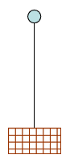

常见的接地体结构包括单根垂直接地极（一根带尖头的金属棒），双根垂直接地极和水平连接线（两根接地棒通过水平金属带连接）或者接地网（多根垂直接地极结合网格状的水平接地带）。

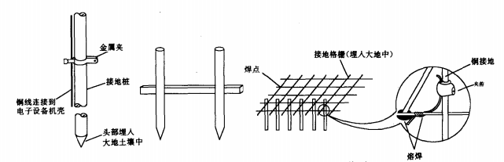

接地介质的电导率会影响接地电阻，通常可以通过降阻剂等化学物质改善土壤电导率。

> **接地电阻计算：**
>
> 1. 垂直接地极
>
>    适用于圆钢、角钢、钢管等垂直打入土壤的接地体。当长度 $l$ 远大于直径 $d$ 时：
>    $$
>    R_v = \frac{\rho}{2\pi l} \left( \ln \frac{8l}{d} - 1 \right)
>    $$
>    式中，$\rho$ 为土壤电阻率；$l$ 为接地极长度；$d$ 为接地极直径或等效直径。
>
>    对于非圆截面导体，需先换算等效直径 $d$，扁钢取 $d = \frac{b}{2}$，等边角钢取 $d = 0.84b$。
>
> 2. 水平接地极
>
>    适用于扁钢或圆钢水平埋设的情况：
>    $$
>    R_h = \frac{\rho}{2\pi L} \left( \ln \frac{L^2}{h d} + A \right)
>    $$
>    $L$ 为水平接地极总长度；$h$ 为埋设深度；$d$ 为直径或等效直径；$A$ 为形状系数，取决于接地极的平面布置形状。
>
> 3. 接地网
>
>    估算公式如下：
>    $$
>    R \approx \frac{0.5\rho}{\sqrt{S}}
>    $$
>    $S$ 为接地网面积。
>
>    多根接地体靠得越近，相互间的屏蔽作用越强，实际等效电阻会大于单纯的并联值。此时需引入利用系数 $\eta$。
>    $$
>    R_{\text{总}} = \frac{R_{\text{单根}}}{n \cdot \eta}
>    $$
>
> 若计算目的是防雷接地，则需要引入冲击系数 $\alpha$（小于 1）：
> $$
> R_{\text{冲击}} = \alpha \cdot R_{\text{工频}}
> $$

### 电力系统接地

电力系统中，设备的机壳必须接到大地上，接地线称为 PE 线。

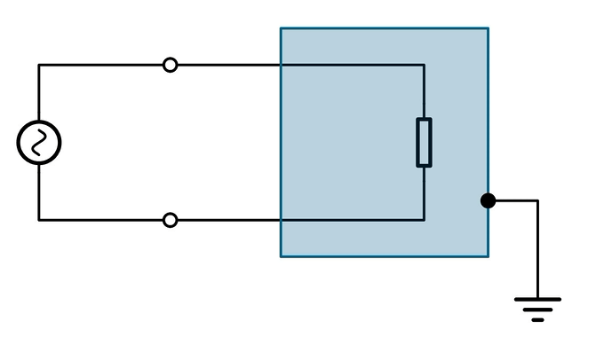

如果机壳没有接地，如果机壳内设备绝缘不良，导致设备漏电或者与机壳短路，一旦人触摸机壳，由于人体提供了电流通路，电流会经过人体通入大地，带来触电风险。如果机壳良好接地，人触摸机壳时，由于地线的电阻低于人体电阻，电流大部分通过 PE 线流到地面，保护人体安全。

---

**电力系统的接地方式：**

1. IT 系统：电源端中性点不接地，用户侧设备外壳接地。（保护接地）

   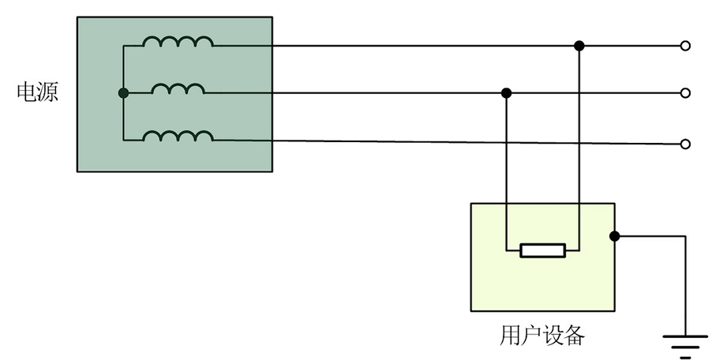

   IT 系统的供电连续性很高，如果发生单相接地故障，由于电源侧中性点不接地，故障电流是系统对地的电容电流，数值较小不至于跳闸。系统会发出绝缘报警。

   IT 系统如果发生二次故障则会形成相间短路，直接跳闸。同时 IT 系统对线路距离和绝缘要求苛刻。

2. TT 系统：电源端和用户端接地。（保护接地）

   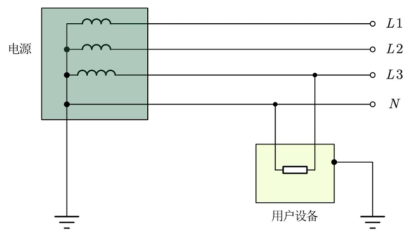

   TT 系统的接地是相互独立的，一旦发生漏电，将会形成 相线 - 设备外壳 - 设备接地线 - 地 - 电源中性点接地 - 电源。由于回路总阻抗较高，故障电流较小，不足以触发跳闸，导致设备外壳长期带有危险电压。TT 系统的保护依赖于漏电保护器，只要电流漏到大地则切断电源。

3. TN 系统：电源端接地，用户端的接地通过导线和电源的地相连（保护接零）

   TN 系统分为 TN-C 系统（PE 线和 N 线共用），TN-S 系统（PE 线和 N 线分离），TN-C-S（用户配电箱前 PE 和 N 共用，配电箱后 PE 和 N 分离）

   TN-C 系统：

   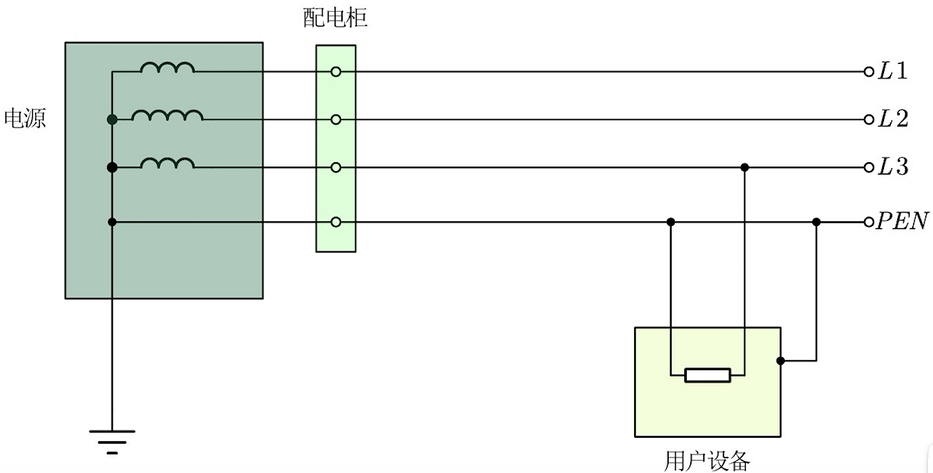

   TN-S 系统：

   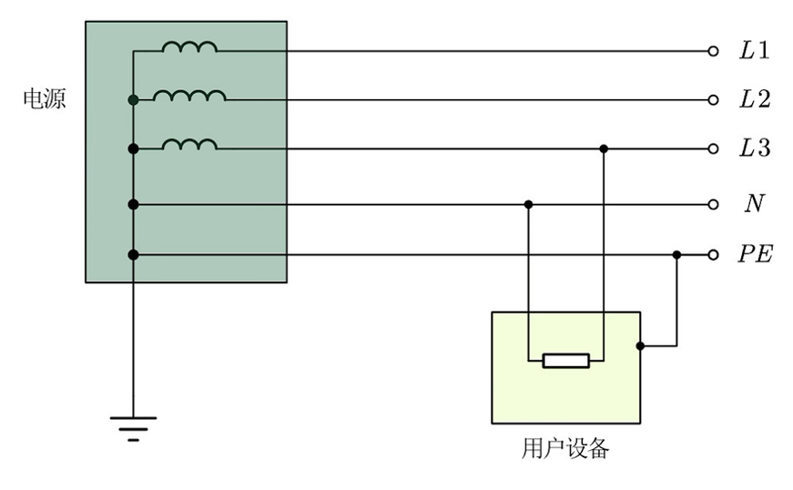

   TN-C-S 系统：

   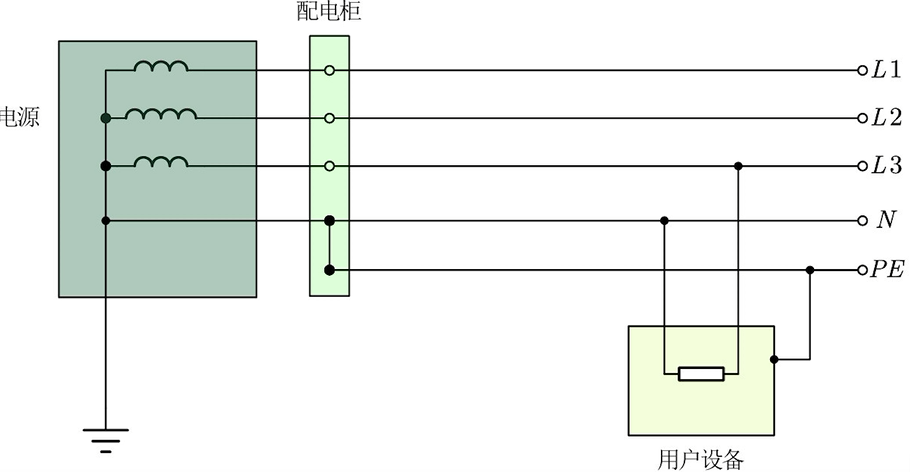

   TN 系统发生设备碰壳时，相线通过 PE/PEN 线形成单相短路，此时可以跳闸以切断故障。

   > TN-C 系统节省导线、较经济；但是正常运行时 PEN 线有不平衡电流通过，导致设备外壳带电位；若 PEN 线断线，外壳可能带上近 220V 危险电压；无法安装漏电保护器防人身电击。
   >
   > TN-S 系统正常运行时 PE 线没有电流通过，设备外壳不带电位，安全可靠性高。缺点是需多敷设一根导线，成本略高。

## 2. 信号接地

在电路分析中，通常认为地是等电位的，但是实际上地存在阻抗，导致地并不等电位。由地导体上的阻抗带来的噪声称为公共地耦合。

> 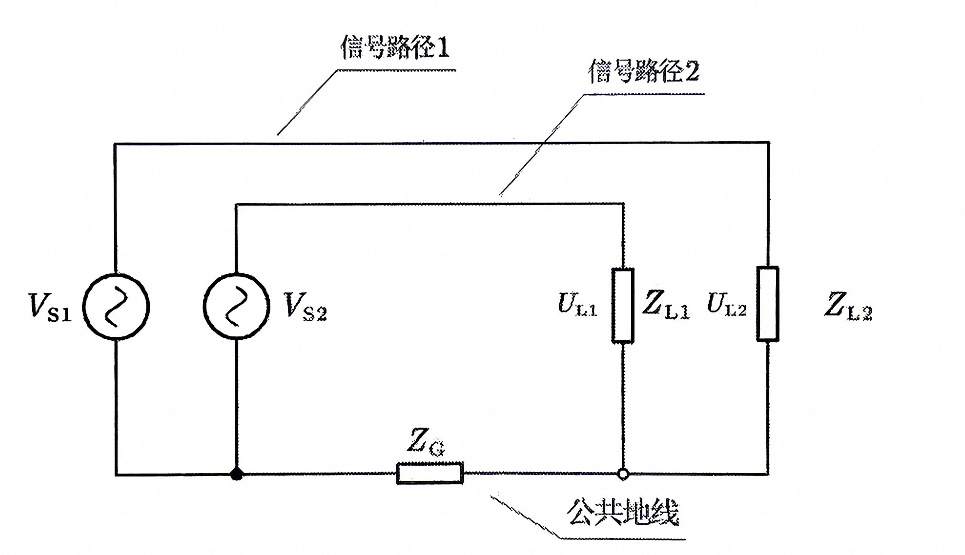
>
> 如图所示，两个负载接收到的信号电压为：
> $$
> U_{L1} = V_{S1}-U_G \\
> U_{L2} = V_{S2}-U_G
> $$
> 地导体上有公共阻抗 $Z_G$，其噪声电压为：
> $$
> U_G = V_{S1}\frac{Z_G}{Z_G+Z_{L1}}+V_{S2}\frac{Z_G}{Z_G+Z_{L2}}
> $$

---

**浮地：**

浮地一般指**工作电路的参考点和大地/外壳隔离**。

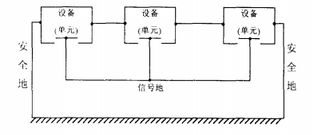

浮地时，机壳/大地中的干扰电流和工作电流间的耦合减小，可以抑制安全地上的浪涌电压/高频噪声/静电放电等引入的干扰。

一般很难做到理想浮地。高频下寄生电容的存在仍然会使得安全地上的干扰电流耦合到工作电路中；浮地系统靠近高压系统时可能会堆积静电荷造成静电放电。

---

**单点接地：**

单点接地包括星形接地和串联接地。

- 串联接地

  串联接地如图所示：

  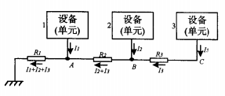

  各个点的地电位为：
  $$
  U_A = (I_1+I_2+I_3)R_1 \\
  U_B = (I_1+I_2+I_3)R_1+(I_2+I_3)R_2 \\
  U_C = (I_1+I_2+I_3)R_1+(I_2+I_3)R_2+I_3R_3
  $$
  A，B，C 的电位不为 0，而且受到其他电路影响。

  串联接地是最常用的接地方式，因为各个单元的接地线可以非常短，接地结构可以非常简单。

  需要注意的是，如果各个单元电流相差很大，不宜使用串联接地，此时单元间的共地耦合会很大。

  一般需要将最低电平电路放在最靠近接地点的 A 处，以减小 B，C 点受到的影响。(放大器电路)

- 星形接地

  星形接地如图所示：

  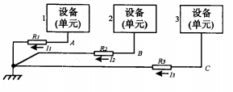

  各个点的地电位为：
  $$
  U_A = I_1R_1\\
  U_B = I_2R_2\\
  U_C = I_3R_3
  $$
  各个单元的地电位只和自己的电流和地电阻有关系，可以有效的防止各个单元间的相互干扰。

  星形接地不适用于高频电路，因为并行的接地线的寄生电容/寄生互感会导致更大干扰；但是在低频条件下可以有良好的抗干扰效果。星形接地的布线会非常复杂，通常也会增加地线长度。

---

**多点接地：**

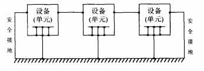

每个单元的地线直接连接到参考导体上，参考导体一般是一个很大的地平面。多点接地可以有效的减小接地线的长度，同时大的地平面可以提供很小的阻抗，使得地平面近似等电位。高频系统中通常选择多点接地。

多点接地容易造成接地环路，此时会引入公共地耦合：

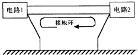

> **隔断接地环路：**
>
> 1. 隔离
>
>    采用隔离的方式可以隔断接地环路。使用隔离器件(隔离变压器/光耦，隔离通信芯片/隔离 ADC)配合隔离电源可以隔断接地环路。
>
>    隔离变压器如图所示，注意使用隔离变压器时，变压器绕组之间会形成分布电容，因此该方法在高频下对接地环路的隔离效果较差。
>
>    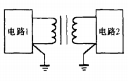
>
>    光耦如图所示，输入端为放光二极管，其光强随输入电流的变化而变化；输出端为光敏三极管，随光强变化控制输出电流。数字电路中可使用数字光耦，模拟电路中一般使用线性光耦。
>
>    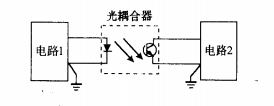
>
> 2. 共模扼流圈/差分传输
>
>    串联共模扼流圈可以抑制地平面造成的干扰，且在高频情况下效果更好。
>
>    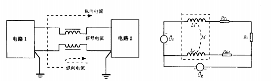
>
>    由于地环路干扰常常是共模干扰，使用差分传输可以抑制共模干扰。
>
>    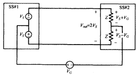
>
>    差分传输的一个例子是差分放大器：
>
>    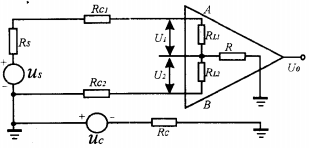
>
>    > 放大器输出电压为 $U_0 = K_s(U_1-U_2)$；
>    >
>    > 当负载 $R_L$ 远大于接地电阻 $R_G$，且 $R=0$ 时，地噪声引起的输入噪声为：
>    > $$
>    > U_n = U_1 - U_2 = (\frac{R_{L1}}{R_{L1}+R_{C1}+R_S}-\frac{R_{L2}}{R_{L2}+R_{C2}})U_G
>    > $$
>    > 如果信号源电阻很小，阻抗平衡（$R_L$ 相等，$R_C$ 相等），则 $U_G \approx 0$。增大放大器的输入阻抗可以减小输入噪声。
>    >
>    > 接入电阻 $R$ 可以减小输入噪声。一般使得接地电阻 $R_G \ll R_{AB}+R$，则：
>    > $$
>    > U_n = U_1 - U_2 = \left( \frac{R_{L1}}{R_{L1} + R_{C1} + R_S} - \frac{R_{L2}}{R_{L2} + R_{C2}} \right) U_{AB} \\
>    > U_{AB} = \frac{R_{AB}}{R_G + R + R_{AB}} U_G
>    > $$
>    > 可以看到 $R$ 可以减小输入噪声。

---

**混合接地：**

将单点接地和多点接地的方式相结合:

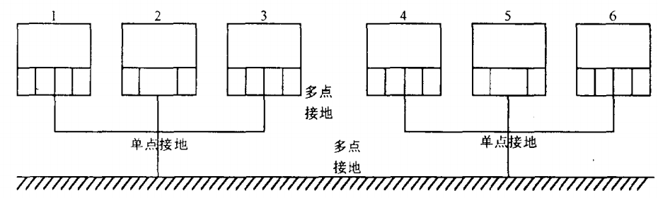

如果噪声存在低频和高频，可以使用低频单点接地配合高频多点电容接地的方式进行混合接地。

---

**电源树：**

按照产生的干扰大小和受扰能力，将单元分为以下几类：

1. 保护地：该地一般接大地；
2. 大功率电源地(功率地)：通常是噪声源，通常是电力电子的主电路地；
3. 数字地(信号地)：数字器件的地，通常是噪声源，本身抗扰性能较高；
4. 模拟地(信号地)：模拟器件的地，本身抗扰性能差。

不同类型的地之间通常采用单点接地以避免公共地耦合。

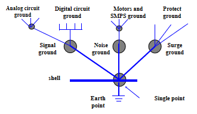

