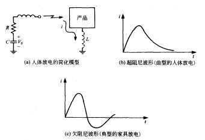
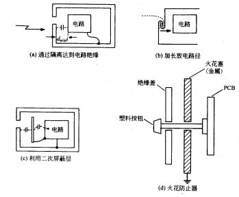

# ESD

ESD (静电放电) 是由于静电荷的分离造成的。

> - **带静电**：摩擦可以使得电子可以从一种材料转移到另一种材料，使两个材料带上不同的电荷。当两种材料分开后，这些分离的电荷会形成电场，使两者之间存在电压差。
> - **静电放电**：空气被击穿/接触导体。电场足够强时，原本起绝缘作用的空气形成放电通路，出现火花或电弧；或者带电物体接触导体后，可能形成直接导电的放电路径。

如果 ESD 放电电流进入敏感的电子电路，就可能造成元件的非线性和电路的响应异常，严重时放电引起的电压或电流超过元件能够承受的范围，损坏半导体器件。

## 1. ESD 的形成

物体可以通过**接触-分离**和**静电感应**，形成电荷分离。

- 接触-分离：两种材料接触时，可能发生电荷转移；分开后，一方带正电，另一方带负电。(摩擦可以增加接触和分离的时间)
- 静电感应：带电物体靠近导体，带电物体的电场会使导体内部的自由电荷重新分布。(电荷重新分布时，导体整体可以仍然不带净电荷；如果通过接地等方式与外界交换了电荷，导体才可能留下净电荷)

> ESD 手环通过 1MΩ 电阻为人体提供一条持续泄放静电的路径，使人体与工作台、产品之间保持较小的电位差，减少接触时发生静电放电的机会。

---

电荷产生后如果不容易泄放就会积累。

对于绝缘体，电荷不容易移动，可能长期停留在某个局部区域；对于导体，电荷容易移动，但如果导体与大地及其他物体绝缘，电荷同样可能保留下来。如果材料的电阻越大，电荷越难泄放。

积累的电荷与物体的电容共同决定电压；电容很小时，少量电荷也能形成高电压。日常物体与周围环境之间的电容可能只有几十到几百 pF，因此日常的摩擦也会导致很高的静电电压。

当带电物体与另一个物体之间形成放电通路，积累的电荷就会快速转移，产生 ESD。ESD 波形由整个路径的 RLC 共同决定。如果路径的阻尼较大，电流升到峰值后逐渐衰减 (人体放电)；如果路径的阻尼较小，电流可能产生振荡（家具放电）。

---

放电前，电荷分离形成的强电场可能损坏器件或者破坏绝缘。

放电发生后，快速释放的电荷可能造成以下影响：

| 途径               | 放电过程                                               | 结果                               |
| ------------------ | ------------------------------------------------------ | ---------------------------------- |
| 直接传导           | 放电电流经过电子器件或电路                             | 电流直接流入设备内部               |
| 二次电弧、二次放电 | 外部放电使设备内部某些金属部件之间再次发生放电         | 外面放了一次电，里面又出现新的放电 |
| 容性耦合           | 放电产生的快速变化电场，通过部件之间的电容关系影响电路 | 没有直接接触，也能通过电场传入干扰 |
| 感性耦合           | 放电电流产生快速变化的磁场，在附近回路中感应出电压     | 放电路径附近的电路回路受到磁场影响 |

## 2. ESD 的防止措施

---

***防止静电荷产生：***

选择合适的材料、包装和工艺，使物体不容易产生或长期保存大量电荷。(使用防静电包装)

---

***ESD 分流：***

1. **外壳分流**

   一般使用金属外壳承接外部放电，并对内部电路提供屏蔽。设计得当时，放电电流主要沿外壳及其连接路径流动，金属外壳需要接地。(塑料外壳可以阻挡直接接触，却不能像连续金属外壳那样提供同等的电磁屏蔽；外部放电产生的场仍可能耦合到内部电路)

   需要注意，接地线的寄生电感会导致放电瞬间外壳相对远处大地的电位仍可能升高，因此应当尽量减小线路接地的寄生电感。

   外部连接电缆的接地、外壳连接和屏蔽连接，应集中考虑，尽量在入口附近完成合理连接。

2. **防止二次放电**

   外部 ESD 在金属外壳上分流之后，金属外壳上的电位可能会发生迅速的变化，如果外壳和内部电路的电位差过大，可能会在设备内部再次形成 ESD。

   防止二次放电的方法分为：

   > - **防止内部 ESD 产生**：增加距离，设置绝缘隔挡，延长可能的放电路径。
   > - **使得内部 ESD 通过预先设置的金属结构分流**：设置二次屏蔽层，在塑料按钮、操作杆附近设计火花防止器。

   

3. **电缆**

   在电缆穿过设备外壳的位置进行屏蔽和增加共模滤波，以防止 ESD 传入内部设备。

4. **接口 ESD 设计**

   接口 ESD 主要通过分流的方式对 ESD 进行抑制。

   接口上可以使用 ESD 防护器件进行防护，常见的器件如下：

   | 器件                 | 作用                                 |
   | -------------------- | ------------------------------------ |
   | TVS (瞬态抑制二极管) | 过压时导通，分流电流并限制电压       |
   | 导流二极管           | 将正、负瞬态引向电源轨或专用钳位节点 |
   | 串联电阻             | 限制后级电流/与电容形成滤波网络      |
   | 并联电容             | 为快速瞬态提供旁路/参与后级滤波      |

   另外可以使用以下器件：
   
   | 器件/结构                 | 作用                                             |
   | ------------------------- | ------------------------------------------------ |
   | GDT (气体放电管)          | 过压时导通，分流电流并限制电压，但是击穿电压较高 |
   | TBU (瞬态阻断器件/保险丝) | 串联限制后续电流                                 |
   | 聚合物 ESD 抑制器         | 在附加电容预算很紧的线路上分流                   |
   | 压敏电阻／MLV             | 利用非线性导通限制瞬态                           |
   | PCB 火花间隙              | 设置优先放电位置，作为补充泄放结构               |

   > **TVS 选型要点：**
   >
   > | 参数      | 含义                                       | 选型要点                     |
   > | --------- | ------------------------------------------ | ---------------------------- |
   > | $U_{RWM}$ | 最大反向工作电压/反向截止电压/反向关断电压 | 覆盖线路的全部正常电压范围   |
   > | $U_{BR}$  | 反向击穿电压                               | 判断进入击穿区的位置         |
   > | $U_{CL}$  | 钳位电压                                   | 判断放电时留给后级的电压应力 |
   >
   > 通常：
   > $$
   > U_{RWM} < U_{BR} < U_C
   > $$
   > 选型需要根据电压参数和后级脉冲耐受能力选型。
   >
   > 对于高速信号，还需要考虑电容 $C_{L}$。
   >
   > 对于可能的双向脉冲，需要使用双向 TVS 进行防护。在瞬态 ESD 的正周期期间，两个二极管中的一个正向偏置，另一个反向偏置，这意味着一个二极管由于其正向偏置而导通，而另一个二极管则以雪崩模式工作，因此两个二极管都形成了一条从 ESD 源通向地的路径。
   >
   > TVS 布局应当尽量贴近接口以减小 ESD 泄放路径的寄生阻抗。根据这个原则，TVS 的接地侧应该采用大面积接地。同时需要设计电流路径能够强制经过 TVS (下图的左图和右图，中图是不合适的布局)：
   >
   > 
